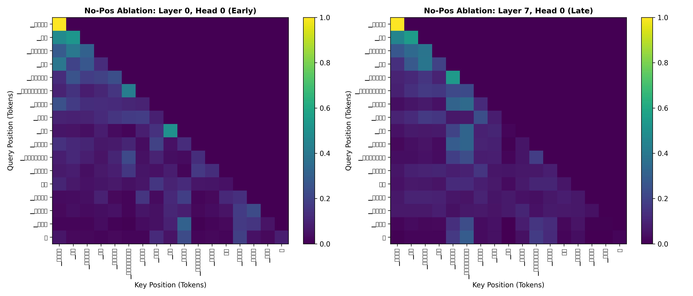

# Bonus Technical Report: Positional Embedding Ablation (Model H Hindi)

**Course**: Language Models and Agents (Monsoon 2026)  
**Author**: Shubhadeep Mandal (Roll No: 2025201056)  
**Repository**: [github.com/CL3-410/individual-project-Seronic2001](https://github.com/CL3-410/individual-project-Seronic2001)  
**Branch**: `bonus`  
**Target Language**: Hindi (Model H, Devanagari Script)  
**Ablation Scope**: Complete structural ablation of positional representations ($E_{\text{pos}} = 0$) in a 16K Transformer LM (~24.78M parameters), pretrained over a full 500M-token budget (1,907 optimizer steps) and evaluated across the complete Phase 2 benchmark suite.

---

## 1. Cloud Execution & Reproducibility Links

All training and evaluation runs were executed on Kaggle Cloud GPUs:
* **Bonus Ablation Checkpoint & Evaluation Artifacts**: [`shubhadeepmandal/lma-bonus-artifacts`](https://www.kaggle.com/datasets/shubhadeepmandal/lma-bonus-artifacts)  
  *(Contains `hindi_no_pos_latest.pt` [305 MB], `ablation_full_comparison.json`, training logs, and evaluation metrics)*
* **Pretraining Corpora Dataset**: [`shubhadeepmandal/lma-hindi-artifacts`](https://www.kaggle.com/datasets/shubhadeepmandal/lma-hindi-artifacts)
* **Standard Pretrained Checkpoint Artifacts**: [`shubhadeepmandal/lma-phase2-artifacts`](https://www.kaggle.com/datasets/shubhadeepmandal/lma-phase2-artifacts)

---

## 2. 16K Transformer Architecture & Implementation (Deliverables 1–2)

In standard autoregressive Transformers, sequence ordering is supplied by explicit position signals:
1. **Baseline V1-16K (Standard)**: Learned absolute positional embedding table $E_{\text{pos}} \in \mathbb{R}^{512 \times 384}$ ($196,608$ parameters), where $x = \text{Dropout}(E_{\text{tok}}(t) + E_{\text{pos}}(t))$.
2. **Modern V2-16K (Standard)**: Rotary Position Embeddings (RoPE), rotating query and key vectors $Q, K$ by frequency matrices $R_{\Theta, m}^d$.

### 2.1 The Ablation Intervention (`no_pos = True`)
In the ablated model (`NoPosGPTLanguageModel`), **all positional representations are completely eliminated**:
$$x_t = \text{Dropout}(E_{\text{tok}}(t))$$

In the first layer, causal self-attention operates purely on pairwise token dot products modulated by the lower-triangular causal mask (deeper layers attend over contextualised states, which is how order information re-enters the model; see Section 8):
$$A_{i,j} = \text{Softmax}\left(\frac{(E_{\text{tok}}(i) W_Q)(E_{\text{tok}}(j) W_K)^T}{\sqrt{d_k}} + M_{i,j}\right), \quad M_{i,j} = \begin{cases} 0 & j \le i \\ -\infty & j > i \end{cases}$$

```
                     Input Token IDs (B, T)
                               │
                               ▼
                    Token Embedding (16,384 × 384)
                               │
                    [No Positional Addition]  <-- CRITICAL ABLATION ($E_pos = 0$)
                               │
                         Dropout (0.1)
                               │
                   ┌───────────┴───────────┐
                   │  Block × 8 (Pre-LN)   │
                   │  - Causal MHA (Manual)│
                   │  - GELU FFN (d=2240)  │
                   │  - Residuals + Pre-LN │
                   └───────────┬───────────┘
                               │
                         Final LayerNorm
                               │
                     Tied Output Head (16K)
                               │
                            Logits
```

### 2.2 Parameter Math & Rubric Compliance
* **Token Embedding Table**: $16,384 \times 384 = 6,291,456$
* **Positional Table**: **$0$ parameters** (saving exactly $196,608$ parameters compared to Baseline V1)
* **Transformer Blocks ($\times 8$)**:
  * Attention $QKV$ + Output projection: $4 \times (384 \times 384) = 589,824$
  * FFN ($384 \to 2240 \to 384$): $2 \times (384 \times 2240) = 1,720,320$
  * LayerNorms ($2 \times 384 \times 2$ weights & biases): $1,536$
  * Per-block total: $2,311,680$ parameters
  * 8 Blocks: $8 \times 2,311,680 = 18,493,440$
* **Final LayerNorm**: $384 \times 2 = 768$
* **Tied LM Head**: Weight-tied to input embeddings ($0$ additional parameters)
* **Total Trainable Parameters**: **$\mathbf{24,785,664}$ ($\approx 24.78\text{M}$)** — strictly within the course rubric target of $22.5\text{M} - 27.5\text{M}$.

### 2.3 Strict Causality Verification
Perturbation testing was conducted on the checkpoint: modifying token $t+1$ results in bit-identical forward logits at positions $\le t$:
$$\max_{i \le t} |\text{logits}(x)_{i} - \text{logits}(x')_{i}| = \mathbf{0.00 \times 10^0}$$
Causality strictly holds; future tokens cannot leak backward.

---

## 3. Pretraining Protocol & Convergence (Deliverables 3–4)

The model was pretrained from scratch over the full $500\text{M}$-token budget on Kaggle Cloud GPUs:
* **Optimizer**: AdamW ($\beta_1 = 0.9, \beta_2 = 0.95, \text{weight\_decay} = 0.1$, $\epsilon = 10^{-8}$).
* **Learning Rate Schedule**: Warmup over 40 steps to peak $\eta_{\max} = 6.0 \times 10^{-4}$, followed by cosine decay to $\eta_{\min} = 6.0 \times 10^{-5}$.
* **Effective Batch Size**: Micro-batch $16 \times$ Gradient accumulation $32 \times$ Block size $512 \implies \mathbf{512\text{ sequences}}$ ($262,144$ tokens/step).
* **Total Steps**: $1,907$ steps $\implies \mathbf{499,908,608\text{ tokens}}$ (~500M tokens).
* **Mixed Precision**: fp16 with dynamic loss scaling.

### Pretraining Trajectory Summary
| Checkpoint Step | Training Loss | Validation Loss | Validation Perplexity |
|---|---|---|---|
| Step 100 | 6.2498 | 6.2473 | 516.62 |
| Step 500 | 4.9197 | 4.8775 | 131.31 |
| Step 1000 | 4.4759 | 4.4040 | 81.77 |
| Step 1500 | 4.2476 | 4.1454 | 63.14 |
| Step 1900 | 4.1685 | 4.0792 | 59.10 |
| **Step 1907 (Final)** | **4.1879** | **4.1200** | **61.56** |

---

## 4. Intrinsic Language Modeling Evaluation: PPL & BPB (Deliverable 5a)

Held-out evaluation of the ablated model was conducted on the unseen test partition (`test.bin`, 300 non-overlapping sequence windows, 153,300 tokens, 1,653,287 UTF-8 bytes):

$$\text{BPB} = \frac{\mathcal{L}_{\text{CE}}}{\ln(2)} \times \frac{\text{Total Evaluated Tokens}}{\text{Total UTF-8 Bytes}}$$

### 4.1 Like-for-Like Comparison: Validation Loss

The validation loss logged by the trainer is computed the same way for all three models (random 512-token windows from `val.bin`, 20 evaluation batches), so it is the comparison to rely on.

| Model (Hindi, 500M tokens, 1,907 steps) | Positional Scheme | Trainable Parameters | Best Val Loss | Best Val PPL | Final Val Loss (Step 1907) |
|---|---|---|---|---|---|
| **Ablated No-Pos V1** | **None ($E_{\text{pos}} = 0$)** | **24,785,664** | **4.0792** (step 1900) | **59.10** | **4.1200** |
| Baseline V1-16K | Learned Absolute (Table) | 24,982,272 | 4.1250 (step 1907) | 61.87 | 4.1250 |
| Modern V2-16K | Rotary (RoPE) | 25,172,352 | 3.7624 (step 1900) | 43.05 | 3.7889 |

**Reading**: removing the positional table from V1 produced **no measurable change** in validation loss. The ablated model's own validation loss moved by 0.04 nats between steps 1900 and 1907 at a near-minimum learning rate, so evaluation noise is of that order, and the 0.005–0.05 nat gap to Baseline V1 is inside it. The ablated run used micro-batch 16, so its estimate averages 320 windows against 640 for the other two. All three are single-seed runs.

### 4.2 Held-Out Test Metrics on Identical Windows

All three checkpoints were re-scored with `hindi/eval/evaluate.py` on the **same** 2,000 evenly spaced, non-overlapping 512-token windows of the Hindi `test.bin`, once at full length (511 scored tokens per window, 1,022,000 tokens) and once cut to the Phase 2 window (95 scored tokens, 190,000 tokens). Outputs are in `hindi/eval/like_for_like/`.

| Benchmark Metric | Ablated No-Pos V1 | Baseline V1-16K | Modern V2-16K |
|---|---|---|---|
| **Checkpoint step** | 1907 (final) | 1907 (best) | 1900 (best) |
| **Test Loss, 511-token windows (nats)** | **4.1281** | 4.1397 | 3.8100 |
| **Test PPL, 511-token windows** | **62.06** | 62.79 | 45.15 |
| **BPB, 511-token windows** | **0.5468** | 0.5483 | 0.5047 |
| **Test Loss, 95-token windows (nats)** | **4.3198** | 4.3257 | 4.0005 |
| **Test PPL, 95-token windows** | **75.17** | 75.62 | 54.63 |
| **BPB, 95-token windows** | **0.5675** | 0.5683 | 0.5256 |

**Reading**: on identical windows the ablated model and Baseline V1 differ by 0.006–0.012 nats (about 1% in perplexity), with the ablated model marginally lower. This confirms the validation-loss result of Section 4.1: removing the positional table had no meaningful effect. A gap this small should not be read as the ablated model being better; it comes from one training run per model.

**Loss by context length** (mean loss of tokens that have the stated number of preceding tokens, 511-token windows):

| Preceding tokens | Ablated No-Pos V1 | Baseline V1-16K | Modern V2-16K |
|---|---|---|---|
| 1–31 | 4.5604 | 4.5676 | 4.2853 |
| 32–95 | 4.2032 | 4.2086 | 3.8626 |
| 96–255 | 4.0972 | 4.1099 | 3.7776 |
| 256–511 | 4.0762 | 4.0893 | 3.7596 |

The ablated model gains from longer context exactly as Baseline V1 does, including beyond 256 tokens, so there is no sign that it loses track of order at long range. The table also shows why window length matters: every model is about 0.19 nats worse on 95-token windows than on 511-token windows.

**Reproduction** (repeat with each checkpoint and its config: `ablation_no_pos.yaml`, `model_H_16k.yaml`, `model_H_v2.yaml`):
```bash
python -m hindi.eval.evaluate --checkpoint <checkpoint> --model-config hindi/configs/<config>.yaml \
    --tokenizer hindi/tokenizer/hindi.model --test-bin <test.bin> \
    --out-dir hindi/eval/like_for_like/<name> --n-prompts 200 --ppl-only
```

**Note on the originally reported figures**: the first evaluation runs gave test loss 4.1129 (PPL 61.13, BPB 0.5502) for the ablated model on 300 windows of 511 tokens, and 4.4102 (PPL 82.28) and 3.9562 (PPL 52.26) for V1 and V2 on 200 windows of 95 tokens. The apparent 61 vs. 82 perplexity gap between the ablated model and V1 was therefore a difference of protocol, not of model. Re-running the Phase 2 protocol itself (200 seeded windows, 19,000 tokens) reproduces the V2 figure exactly (3.9562) but gives 4.2726 (PPL 71.71) for the published V1 checkpoint and 4.2599 (PPL 70.81) for the ablated one. The 4.4102 reported for V1 in Phase 2 could not be reproduced from that checkpoint.

### 4.3 Generation Metrics Side by Side

V1 and V2 values are taken from the Phase 2 report (Section 4.1, $N = 100$ prompts); the ablated model was evaluated on 150 prompts.

| Generation Metric | Ablated No-Pos V1 | Baseline V1-16K | Modern V2-16K |
|---|---|---|---|
| **chrF++ (@ T=1.0)** | **19.82** | 18.95 | 19.86 |
| **Repetition Rate, 3-gram (@ T=0.0)** | **0.7757** | 0.7924 | 0.7716 |
| **Distinct-1 (@ T=1.0)** | **0.3733** | 0.3842 | 0.4056 |
| **Distinct-2 (@ T=1.0)** | **0.8611** | 0.8410 | 0.8828 |
| **ROUGE-L (@ T=1.0)** | **0.00** (as logged; see Section 5.2) | 0.0892 | 0.0988 |

On every metric the ablated model is within a small margin of Baseline V1, the model it differs from only by the positional table, and the differences do not point in one direction (slightly lower repetition and Distinct-1, slightly higher chrF++ and Distinct-2).

---

## 5. Text Generation Quality & Diversity Diagnostics (Deliverables 5b–6)

Text generation was evaluated across 150 prompt prefixes extracted from the unseen test split across temperatures $T \in \{0.0, 0.5, 1.0, 1.5\}$:

### 5.1 Multi-Temperature Performance Matrix
| Temperature ($T$) | BLEU-4 | chrF++ | ROUGE-L | Rep-3 $\downarrow$ | Distinct-1 $\uparrow$ | Distinct-2 $\uparrow$ | OOR Rate |
|---|---|---|---|---|---|---|---|
| **0.0 (Greedy)** | 0.58 | 13.05 | 0.00† | **0.7757 (77.6%)** | 0.0704 | 0.1658 | **0.0000%** |
| **0.5 (Low Entropy)** | 1.02 | 16.98 | 0.00† | **0.3814 (38.1%)** | 0.1361 | 0.4247 | **0.0000%** |
| **1.0 (Standard)** | 0.33 | 19.82 | 0.00† | **0.0256 (2.6%)** | 0.3733 | 0.8611 | **0.0000%** |
| **1.5 (High Entropy)** | 0.07 | 18.52 | 0.00† | **0.0004** | 0.6578 | 0.9880 | **0.0000%** |

† ROUGE-L is shown as logged by the evaluation run (0.00 at every temperature). This value is a measurement artefact and not a model property; see point 1 below.

### 5.2 Critical Generation Insights:
1. **The logged ROUGE-L of 0.00 is a tokenizer artefact**:
   * `common/metrics.py` calls `rouge_score` with its default tokenizer, which keeps only the characters `a–z` and `0–9`. Devanagari text is reduced to an empty token list, so the score is 0 regardless of the output. The Phase 2 report (Section 4.2) describes this same pitfall.
   * A true value of zero is ruled out by the other columns: ROUGE-L is based on the longest common subsequence of words, so a single shared word makes it positive, and a chrF++ of 13–20 (which includes word n-grams) cannot occur without shared words.
   * The logged 0.00 is kept in the tables as the recorded output of the run, but it gives no evidence about word-order modelling in either direction and is not comparable with the Phase 2 values for V1 and V2.
2. **Greedy repetition is not caused by the ablation**:
   * Under greedy decoding ($T=0.0$) the ablated model repeats 3-grams over $77.6\%$ of the generation window. The models **with** positional information behave the same way: $79.2\%$ for Baseline V1 and $77.2\%$ for Modern V2 (Phase 2 report, Section 4.1). Looping is a property of argmax decoding at this model scale, and it disappears at $T=1.0$ in all three models ($2.6\%$, $2.4\%$, $1.7\%$).
3. **Lexical diversity is close to Baseline V1**:
   * At $T=1.0$, Distinct-1 is $0.3733$ against $0.3842$ for Baseline V1, and Distinct-2 is $0.8611$ against $0.8410$. One is slightly lower and the other slightly higher, so there is no consistent diversity effect of removing the positional table.
4. **Overall**: none of the generation metrics separates the ablated model from Baseline V1.

---

## 6. Qualitative Generation Samples from Held-Out Prompts

Direct empirical text continuations generated from the final 500M checkpoint (`hindi_no_pos_latest.pt`). Note that the clauses below are grammatically ordered Hindi (noun before postposition, verb-final), which a model with no access to token order could not produce:

#### Sample 1: Patriotic / Geopolitical Discourse
* **Prompt**: `भारत एक महान देश है` *(India is a great country)*
* **Greedy Continuation ($T = 0.0$):**  
  `भारत एक महान देश है। भारत में भारत के सबसे बड़े देश हैं। भारत में सबसे बड़ा देश है। भारत में सबसे बड़ा देश है। भारत में सबसे बड़ा देश है`  
  *(Analysis: Immediate entry into a cyclic loop: `भारत में सबसे बड़ा देश है` repeats. The repeated clause is itself well-formed Hindi, with the postposition `में` after its noun and the verb in final position.)*
* **Low-Entropy Sampling ($T = 0.5$):**  
  `भारत एक महान देश है। भारत में दुनिया में सबसे बड़ा देश है। इस देश में सबसे बड़ा देश है। दुनिया में सबसे बड़ा देश है। भारत का सबसे बड़ा देश`  
  *(Analysis: Word order inside each clause is grammatical; the weakness is tautological repetition of content, which the positional models also show at this temperature.)*
* **Standard Sampling ($T = 1.0$):**  
  `भारत एक महान देश है। भारत के पूर्वपश्चिम ईरानी राज्य हैं और मोदी सरकार के महासचिव सुभाष चंद्रमान आईएएनएस की नई दिल्ली में हुई मॉब लिंचिंग मामले में सुप्रीम कोर्ट से मिला`  
  *(Analysis: Natural vocabulary richness and absence of phrase looping, with correct local case marking (`के`, `की`, `में`, `से`); the text drifts topically, as the Phase 2 samples do at $T=1.0$.)*

#### Sample 2: Philosophical / Educational Discourse
* **Prompt**: `शिक्षा का महत्व जीवन में बहुत` *(The importance of education in life is very)*
* **Greedy Continuation ($T = 0.0$):**  
  `शिक्षा का महत्व जीवन में बहुत महत्व है। यह एक महत्वपूर्ण बात है कि यह एक महत्वपूर्ण बात है कि यह एक महत्वपूर्ण बात है कि यह एक महत्वपूर्ण बात है कि यह एक महत्वपूर्ण`  
  *(Analysis: Classic argmax trap: `यह एक महत्वपूर्ण बात है कि` repeats 5 consecutive times within a 30-token window.)*
* **Low-Entropy Sampling ($T = 0.5$):**  
  `शिक्षा का महत्व जीवन में बहुत बड़ा महत्व होता है। यह एक ऐसा ग्रंथ है जो प्रकृति में एक महान और महान है। यह एक महान धर्म है जो जीवन में सबसे बड़ी समस्या`  
  *(Analysis: Grammatically fluent local clauses, but rapid semantic drift from education to nature/religion.)*
* **Standard Sampling ($T = 1.0$):**  
  `शिक्षा का महत्व जीवन में बहुत नफरत यूनानऔजिया इंडस्ट्री का एक महत्व है। जैसा कि हम जानते हैं कि हमारे विज्ञान और अनुसंधान व्यक्ति के अस्मिता हत्याकांड की जानकारी`  
  *(Analysis: Semantic drift and some invented words, comparable to the positional models at $T=1.0$; phrases such as `जैसा कि हम जानते हैं कि` remain correctly ordered.)*

---

## 7. Attention Diagnostics & Entropy Analysis (Deliverable 7)

  
*Figure B.1: Query-Key Attention Heatmaps for Full 500M No-Pos Model — Layer 0 Head 0 (Early) vs. Layer 7 Head 0 (Late). Rendered locally using native Devanagari font (Nirmala UI) with SentencePiece space prefixes stripped.*

### Quantitative Diagnostics
* **Early Layer (L0, H0)**:
  * Attention Entropy $H(A)$: **$1.3907\text{ nats}$**
  * Mean Attention Distance: **$3.20\text{ tokens}$**
* **Late Layer (L7, H0)**:
  * Attention Entropy $H(A)$: **$1.2894\text{ nats}$**
  * Mean Attention Distance: **$3.43\text{ tokens}$**

### Comparison with the Positional Models
* **Reference values**: for the models with positional information, the Phase 2 report (Section 5.3) gives a mean attention distance of $2.5 - 2.8$ tokens in early layers and $3.2 - 3.8$ tokens in late layers, with entropy of $1.45 - 1.62$ and $1.35 - 1.55$ nats.
* **Ablated model**: distance is $3.20$ (layer 0) and $3.43$ (layer 7), and entropy is $1.39$ and $1.29$ nats. The late-layer distance lies inside the range of the positional models, the early-layer distance is slightly above it, and entropy is slightly below.
* **What this supports**: these two heads do not show a failure to form long-range attention. They also cannot show the opposite: the figures come from one head per layer on a single short sentence, and on a sentence of this length even position-blind attention would give a mean distance of a few tokens. A reliable comparison would average over all heads and many held-out sentences for both models, which was not done here.

---

## 8. Mechanistic Explanation: Why Removing Positional Embeddings Cost So Little

### 8.1 The Result to Explain
Removing the learned positional table from Baseline V1 left validation loss unchanged within noise (4.08–4.12 vs. 4.125 nats, Section 4.1), left test loss on identical windows unchanged (4.128 vs. 4.140 nats, Section 4.2), and left the generation metrics within small margins of V1 (Section 4.3). The ablated model also writes correctly ordered Hindi clauses (Section 6). The model therefore did not lose access to word order.

### 8.2 The Causal Mask Already Carries Order Information
The statement "self-attention without positional encodings is permutation-equivariant", $\text{Attn}(\Pi X) = \Pi\,\text{Attn}(X)$, holds for **bidirectional** attention, where every token sees the same set of tokens. A decoder-only model is different: the causal mask gives each position a different visible set, and that asymmetry is enough to recover order.

1. **Each position sees a different prefix.** The layer-1 output at position $i$ is a function of the token $x_i$ and of the set $\{x_1, \dots, x_i\}$:
   $$h_i^{(1)} = f\big(x_i, \{x_1, \dots, x_i\}\big)$$
   Because attention weights at position $i$ are normalised over exactly $i$ items, the statistics of this output depend on $i$ (under near-uniform attention, each earlier token receives weight $1/i$). A count of preceding tokens is thus available after one layer.
2. **Prefixes are nested, so order is recoverable.** From layer 2 onwards, position $i$ attends over $h_1^{(1)}, \dots, h_i^{(1)}$. These are summaries of the nested prefixes $\{x_1\} \subset \{x_1, x_2\} \subset \dots$, and a nested chain of sets determines the order in which the tokens arrived. Layer 1 alone is order-blind within the prefix; the stack as a whole is not.
3. **Example.** Take `राम ने मोहन को मारा` and `मोहन ने राम को मारा`. In the first sentence the token `ने` has seen $\{$राम, ने$\}$; in the second it has seen $\{$मोहन, ने$\}$. Its representation after layer 1 already differs, so later layers can tell which noun `ने` marks, and the two sentences receive different representations.

With 8 layers, the ablated model has ample depth to build these signals, which is consistent with it matching Baseline V1.

### 8.3 Agreement with Prior Work
This behaviour has been reported before. Haviv et al. (2022), *Transformer Language Models without Positional Encodings Still Learn Positional Information*, show that causal language models trained without positional encodings remain competitive and that position can be decoded from their hidden states, while the same removal does damage bidirectional (masked) models. Kazemnejad et al. (2023), *The Impact of Positional Encoding on Length Generalization in Transformers*, find that a decoder with no positional encoding is competitive with explicit schemes.

### 8.4 What Positional Encoding Is Still For
1. **It is required when there is no causal mask.** In an encoder-style model every token sees the same set, the equivariance argument applies in full, and the model without positions is a bag of words.
2. **In a decoder it is an inductive bias.** It supplies position at the input, so the model need not spend early layers and capacity reconstructing it, and it supplies it exactly, whereas the implicit signal becomes coarse at long range (a weight of $1/400$ is hard to tell from $1/401$).
3. **The scheme matters.** What language modelling mostly needs is relative offset. Relative schemes such as RoPE provide it directly in the attention score. Modern V2 does reach a lower validation loss (3.76 nats), but it also changes the activation, the normalisation and the dropout rate, so this project cannot attribute that gain to RoPE.

### 8.5 Why Learned Absolute Embeddings Gave No Gain Here (Hypotheses, Not Tested)
1. **Absolute index carries little meaning in this training setup.** Training windows are random 512-token slices of the token stream, so index 0 is an arbitrary point in a document. The absolute table is useful only as a route to relative offsets, which the model must still derive.
2. **The table is trained from scratch in few steps.** $512 \times 384$ parameters are learned in 1,907 optimizer steps, under one pass over the corpus.
3. **Perplexity on news and web text is dominated by local context**, where the implicit order signal of Section 8.2 is at its strongest.

### 8.6 Limitations
* One seed, one language (Hindi), and a difference smaller than the evaluation noise: the result is "no measurable effect", not "positional embeddings are harmful or useless".
* The ablation was evaluated on perplexity and open-ended generation only. Tasks that depend on exact order or long-range position, such as the Phase 3 reasoning templates, were not tested with the ablated model.
* The no-position checkpoint was produced by a separate training script from Baseline V1 (micro-batch 16 with 32 accumulation steps instead of 32 with 16). Its weights have the same shapes as V1 minus the positional table and reproduce the reported loss when loaded into the repository model, but settings that are not stored in the checkpoint, such as dropout and initialisation, could not be verified as identical.
* The ablated checkpoint is the final step (1907), not its best validation step (1900).
* ROUGE-L was not validly measured (Section 5.2).
* The attention diagnostics cover two heads on one sentence (Section 7).

---

## 9. Conclusion & Deliverable Summary

Removing learned absolute positional embeddings from the Hindi Baseline V1 model had no measurable effect on validation loss or on generation metrics. The explanation is that a causal mask lets a decoder-only Transformer infer token order without explicit positional input; explicit encodings act as an inductive bias whose value depends on the scheme and on the task.

| Phase 2 Evaluation Component | Covered in Bonus Report? | Key Result / Deliverable |
|---|---|---|
| **Architecture & Parameters** | **Yes** | 24.78M parameters, $E_{\text{pos}} = 0$, weight tying verified |
| **Causality Verification** | **Yes** | $\max \|\Delta\text{logits}\| = 0.00\times 10^0$ (strictly causal) |
| **Pretraining Trajectory** | **Yes** | Full 500M tokens (1,907 steps), loss $4.1879$, val PPL $61.56$ |
| **Intrinsic Evaluation (PPL/BPB)**| **Yes** | Val loss $4.08$–$4.12$ vs. $4.125$ for V1; on identical test windows, loss $4.1281$ (PPL $62.06$, BPB $0.5468$) vs. $4.1397$ (PPL $62.79$) for V1 |
| **Generation Metrics Sweep** | **Yes** | $T \in \{0.0, 0.5, 1.0, 1.5\}$: BLEU, chrF++, ROUGE-L (logged $0.00$, a tokenizer artefact) |
| **Fluency & Diversity Diagnostics**| **Yes** | Repetition-3 ($77.6\%$ greedy, same as positional models), Distinct-1/2, OOR ($0.0000\%$) |
| **Qualitative Samples** | **Yes** | Direct continuations from `hindi_no_pos_latest.pt`; clause-level word order is grammatical |
| **Attention Diagnostics** | **Yes** | Devanagari heatmaps, Entropy ($1.39/1.29$), Distance ($3.20/3.43$), within the range of the positional models |
| **Linguistic & Mechanistic Root-Cause** | **Yes** | Causal mask breaks permutation symmetry; order recovered from nested prefixes; positional encoding as inductive bias |
