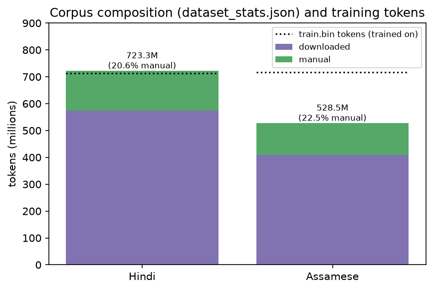
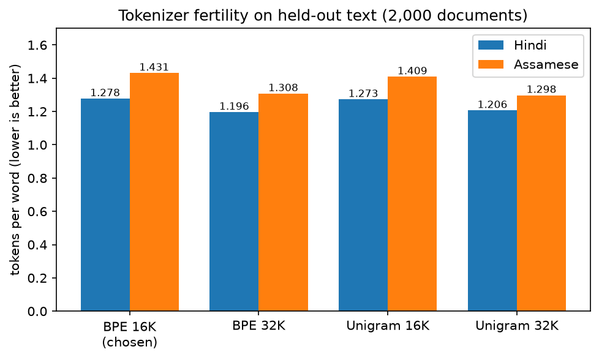
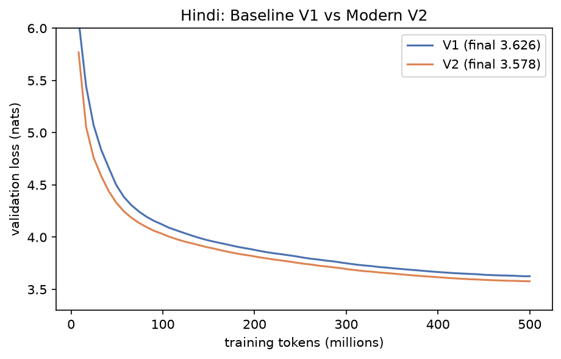
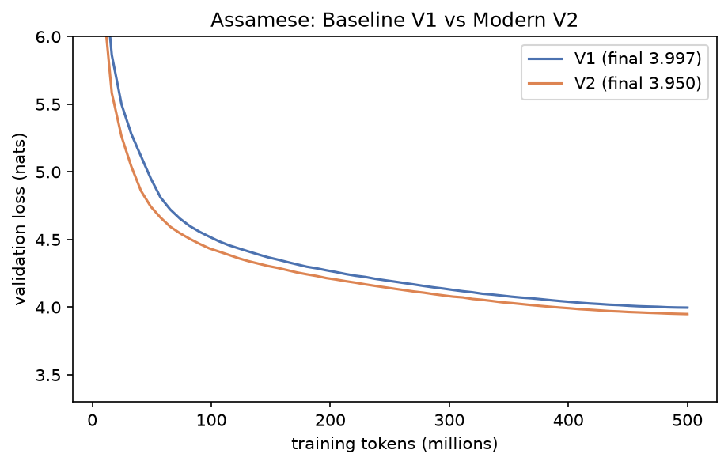
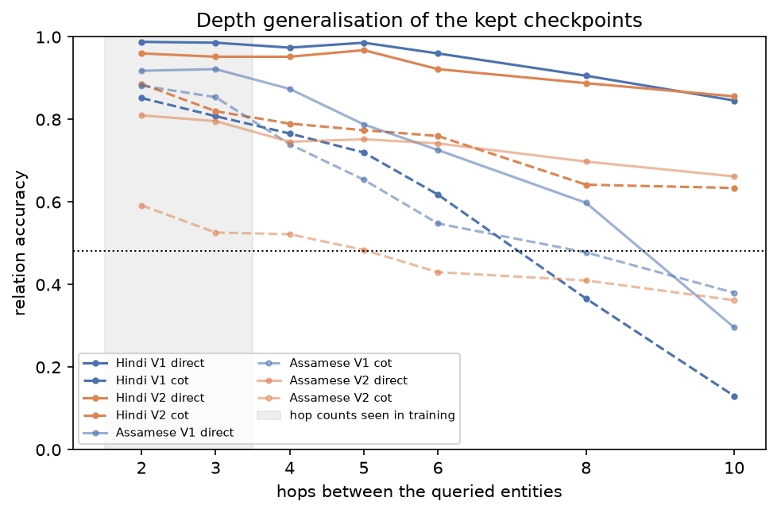
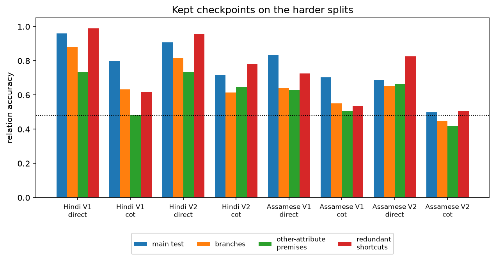
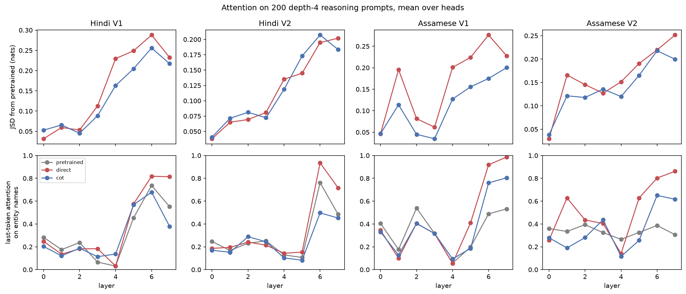

# Pretraining and Reasoning Fine-Tuning of Small Monolingual Indic Transformers: Hindi (Higher-Resource) and Assamese (Lower-Resource)

**Author**: Shubhadeep Mandal (Roll No: 2025201056)  
**Course**: Language Models and Agents (Monsoon 2026)  
**Submission Repository**: [github.com/CL3-410/individual-project-Seronic2001](https://github.com/CL3-410/individual-project-Seronic2001)  
**Branch**: `phase-3` (final snapshot)  
**Languages**: Hindi (Model H, Devanagari) and Assamese (Model L, Eastern Nagari `অসমীয়া`)

Detailed reports: [Phase 1](phase1_report.md) · [Phase 2](phase2_report.md) · [Phase 3](phase3_report.md). Every number is read from [`report/results/`](results/) and every figure is drawn from it by [`report/make_figures.py`](make_figures.py).

---

## Abstract

We built two independent monolingual pipelines, from corpus collection to reasoning fine-tuning, for Hindi and Assamese. Each language has its own 16,384-piece BPE tokenizer (fertility 1.28 and 1.43 tokens per word, no unknown tokens) and two 25M-parameter decoder-only Transformers written from PyTorch primitives: a Baseline V1 (learned positions, GELU, LayerNorm) and a Modern V2 (RoPE, SwiGLU, RMSNorm), each pretrained on 500M tokens. V2 reaches lower held-out perplexity in both languages (Hindi 36.15 vs 38.66; Assamese 51.55 vs 54.53 on 512-token windows), a 5–7% advantage. Fine-tuned on synthetic relational reasoning (44 runs, 2 seeds per recipe), the models learn the task and generalise to chains up to three times longer than any in training: Hindi V1 with Direct SFT scores 0.961 on the test set and 0.846 on 10-hop chains, against a majority baseline of 0.48. A leakage analysis shows the main test is structurally covered by training (a lookup of training answers scores 0.95), so the evidence of reasoning comes from deeper, structurally new splits where that lookup is at chance. Direct SFT beats Chain-of-Thought SFT, V1 beats V2 despite its higher perplexity, and Assamese trails Hindi (best 0.831). Every model is misled by premises about a different attribute. After fine-tuning, attention changes mostly in the late layers, where the answer position concentrates on the entity names.

---

## 1. Pipeline

```
+----------------------------------+------------------------------------+-------------------------------------+
| Phase 1: Data & Tokenization     | Phase 2: Architecture & Pretraining| Phase 3: Reasoning Fine-Tuning      |
| • Hindi 723M, Assamese 528M      | • V1: Pre-LN, GELU, learned pos    | • Symbolic-solver synthetic data    |
|   corpus tokens (estimates)      | • V2: RMSNorm, SwiGLU, RoPE        | • Disjoint name pools, depth splits |
| • NFC/NFKC, script filter, OCR   | • 8 layers, 384 dim, ~25M params   | • Direct vs CoT SFT, 2 seeds        |
|   repair, SHA-256 + MinHash dedup| • 500M tokens, 15,259 steps        | • Leakage + attention analysis      |
| • 16K BPE, byte fallback         | • Test PPL 36.15 (HI), 51.55 (AS)  | • Best test 0.961 (HI), 0.833 (AS)  |
+----------------------------------+------------------------------------+-------------------------------------+
```

---

## 2. Phase Summaries

### 2.1 Phase 1: Corpora and Tokenizers

| | Hindi (Model H) | Assamese (Model L) |
|---|---|---|
| Corpus tokens (`dataset_stats.json` estimate) | 723,321,981 | 528,500,000 |
| Manual collection | 148,676,877 (20.55%) | 118,800,000 (22.48%) |
| Training tokens (`train.bin`, chosen tokenizer) | 714,015,795 | 717,422,008 |
| Tokenizer | 16,384 BPE, byte fallback | 16,384 BPE, byte fallback |
| Fertility (tokens / word) | 1.2776 | 1.4313 |
| Characters / token | 3.7445 | 4.5774 |
| `<unk>` rate | 0.0% | 0.0% |

The Assamese training files were built from a larger set of cleaned sources than its statistics describe (Phase 1, Section 2.2). The cleaning pipeline keeps only characters of each language's script block, so the corpora contain no Latin letters, ASCII digits or ASCII punctuation.


*Figure 1: corpus composition from `dataset_stats.json`; the dotted line marks the tokens in `train.bin`.*


*Figure 2: fertility of the four tokenizer candidates on 2,000 held-out documents. 32K vocabularies are 7–9% more efficient but would leave room for only 6 layers in a 25M-parameter model; Unigram and BPE are within 2% at 16K.*

### 2.2 Phase 2: Pretraining

| Model | Params | Test loss | Test PPL | Test BPB |
|---|---|---|---|---|
| Hindi V1 | 24,982,272 | 3.6547 | 38.66 | 0.4856 |
| Hindi **V2** | 25,172,352 | **3.5876** | **36.15** | **0.4767** |
| Assamese V1 | 24,982,272 | 3.9987 | 54.53 | 0.4634 |
| Assamese **V2** | 25,172,352 | **3.9425** | **51.55** | **0.4569** |

*2,000 non-overlapping 512-token test windows (1.02M predicted tokens) per model.*



*Figures 3–4: validation loss over 500M tokens. V2 leads by 0.31 nats early in training and by 0.05 nats at the end.*

* V2's advantage is consistent across languages and context lengths but small (0.06–0.07 nats); it mostly speeds up early learning.
* Validation loss was still falling at the last step in all four runs: the models are compute-limited.
* Greedy decoding loops (73–77% repeated 3-grams); nucleus sampling gives the best chrF in all four models. V1 and V2 generate text of near-identical quality.

### 2.3 Phase 3: Reasoning

| Model | Direct: test | Direct: 4 / 6 / 10 hops | CoT: test | CoT: 10 hops |
|---|---|---|---|---|
| Hindi V1 | **0.961** | 0.974 / 0.960 / 0.846 | 0.799 | 0.130 |
| Hindi V2 | 0.909 | 0.952 / 0.922 / 0.856 | 0.716 | 0.634 |
| Assamese V1 | 0.833 | 0.874 / 0.726 / 0.296 | 0.704 | 0.380 |
| Assamese V2 | 0.689 | 0.746 / 0.742 / 0.662 | 0.498 | 0.362 |

*Relation accuracy of the checkpoint kept for each model and mode (best validation accuracy across recipes and seeds). Training covers 1–3 hops; majority baseline 0.46–0.53 on every split.*


*Figure 5: accuracy against query depth. Direct models (solid) degrade slowly beyond the training depth; CoT models (dashed) degrade quickly.*


*Figure 6: compared with chains of the same length, irrelevant branches cost the Direct models 0.11–0.28, redundant true premises help three of the four Direct models but hurt Assamese V1 and the CoT models, and premises about another attribute cost the Hindi Direct models 0.22–0.25.*

---

## 3. Synthesis Questions

### Question 1: How did data scale and quality differ between Model H and Model L?

* **Scale.** Both training sets are about 715M tokens with their own tokenizers (Hindi 714.0M, Assamese 717.4M), so the two models saw a similar token budget: 500M pretraining tokens, about 0.7 of an epoch. Measured in text rather than tokens, the Assamese set is larger, since an Assamese token covers 4.58 characters against 3.74.
* **Sources.** Hindi has large published corpora (Sangraha, OSCAR, CC-100) plus literature archives crawled by the project (Gadyakosh, Kavitakosh). Assamese relies more on project crawlers of regional news sites (Asomiya Pratidin, Northeast Now, Niyomiya Barta, Agradoot) and on textbook PDFs, alongside published corpora (an Assamese web corpus, Sangraha, IndicCorp v2).
* **Quality controls** were identical: script filtering, OCR repair, exact and MinHash deduplication. Assamese text needed the extra OCR repairs for its detached genitive `ৰ` and verb suffixes.

### Question 2: How do language-modeling and reasoning results compare across the two resource tiers?

* **Language modeling.** Assamese has higher token perplexity (51.6 vs 36.2 for V2) but lower bits per byte (0.457 vs 0.477): per unit of text, the Assamese model is not worse. The token-level gap reflects longer, more informative Assamese tokens.
* **Reasoning.** Here the lower-resource language is clearly behind: best test accuracy 0.833 vs 0.961, and much weaker on long chains (0.296 vs 0.846 at 10 hops for the V1 Direct models). Assamese results are also less stable across seeds (plain Direct: 0.556 and 0.754 for the two seeds). The best Assamese recipe needed a CoT warm-up (5,000 steps of CoT targets before Direct training), which raised Assamese V1 from 0.655 to 0.831; for Hindi, plain Direct training with half real names was enough.
* So similar compression ability did not mean similar ease of learning the downstream task.

### Question 3: What tokenizer and corpus factors most affected the lower-resource model?

* **Longer names in tokens.** Assamese fertility is 12% higher, and names inflect by suffixation (`সুচিত্ৰাৰ`, `নৰেনৰ`), so the same entity appears as different token sequences in premises and answers. Copying names correctly is a large part of the task: the Assamese V2 Direct model names the queried pair in only 0.82 of its test answers (Hindi V1: 1.00), and its strict accuracy (exact names) is 0.12 below its relation accuracy.
* **Script filtering.** Removing every non-script character also removed ASCII punctuation, so the `?` in every reasoning question is a byte-fallback token in both languages. This affects both models equally and is a corpus-design limitation worth fixing (keeping basic punctuation).
* **Slower, less stable fine-tuning.** The kept Assamese checkpoints come from steps 12,000–15,000 of a 15,000-step schedule, the Hindi ones from steps 2,500–8,500 of 12,000, and the Assamese runs had the higher seed variance: the task is learned later and less reliably on the Assamese models.

### Question 4: What evidence explains the observed differences?

1. **Generalisation, not lookup.** On the main test, a lookup of training answers by premise structure scores 0.95, so main-test accuracy alone cannot show reasoning. On 4–10-hop, branch and redundant splits that lookup scores at chance, and Hindi Direct models still score 0.82–0.99.
2. **Direct vs CoT.** CoT accuracy falls steadily with depth (Hindi V1 CoT: 0.852 at 2 hops, 0.130 at 10) while Direct stays above 0.84: a written rationale gives the model more tokens to get wrong, and the errors compound. At 10 hops the CoT models' answers often stop naming the queried pair (name copy 0.114), so the failure is in carrying the chain through generation, not only in the final comparison.
3. **V1 vs V2.** V2 has the better language model but learns the task less well and copies names less reliably (0.93–0.96 vs 1.00 in Hindi). A plausible explanation, not tested here, is that the learned absolute positions of V1 suit these short, templated prompts; the bonus ablation report studies V1 without position embeddings.
4. **Attention re-wiring.** Fine-tuning leaves layer-0 attention nearly unchanged (JSD 0.03–0.05 from the pretrained model) and changes layers 5–7 several times more. In Direct models the last prompt token, where the answer begins, moves from 0.31–0.55 to 0.72–0.99 of its final-layer attention on entity names; CoT models shift less, consistent with gathering that information later, inside the rationale.
5. **Attribute binding is the shared weakness.** Premises about a different attribute lower Hindi Direct accuracy from 0.95–0.99 on plain 3-hop chains to 0.73 even though the answers name the right pair: the models track who is compared with whom, but not reliably on which attribute.


*Figure 7: per-layer change of attention after fine-tuning (top) and last-token attention on entity names (bottom).*

---

## 4. Artifacts and Reproduction

* **Kaggle artifact datasets (Phase 1):** [`shubhadeepmandal/lma-hindi-artifacts`](https://www.kaggle.com/datasets/shubhadeepmandal/lma-hindi-artifacts), [`shubhadeepmandal/lma-assamese-artifact`](https://www.kaggle.com/datasets/shubhadeepmandal/lma-assamese-artifact): cleaned corpora, token files, tokenizer candidates.
* **Kaggle runs behind the reported results:** `lma-unify-{hindi,assamese}` (tokenizers and token files), `lma-pretrain-{hindi,assamese}-{v1,v2}` (pretraining checkpoints), `lma-eval-pretrained` (Phase 2 evaluation), `lma-finetune` and `lma-finetune-assamese` (fine-tuning sweep), `lma-eval-hard` and `lma-eval-attention` (Phase 3 evaluation). Provenance of each result file: [`report/results/README.md`](results/README.md).
* **Earlier artifact datasets** (`lma-phase2-artifacts`, `lma-phase3-artifacts`, `lma-bonus-artifacts`) hold checkpoints of earlier runs (1,907-step pretraining) and are not the models reported here; the bonus ablation report refers to those runs.
* **Code:** tokenizers `hindi/tokenizer/hindi.model`, `assamese/tokenizer/assamese.model`; models `<lang>/model/`; training `<lang>/train/`; evaluation `<lang>/eval/`; reasoning data and fine-tuning `<lang>/finetune/`; Phase 3 analysis `common/evaluate_finetuned.py`, `common/leakage_check.py`, `common/attention_shift.py`.
* **Figures:** `python -m report.make_figures` redraws every figure from `report/results/`.
