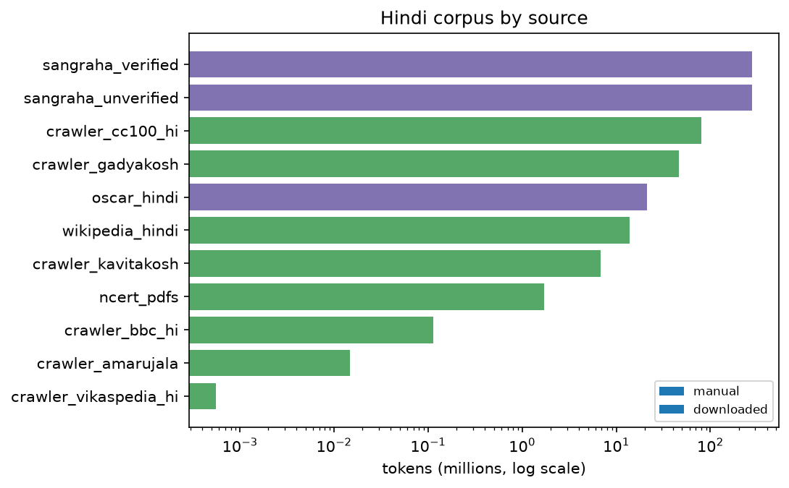
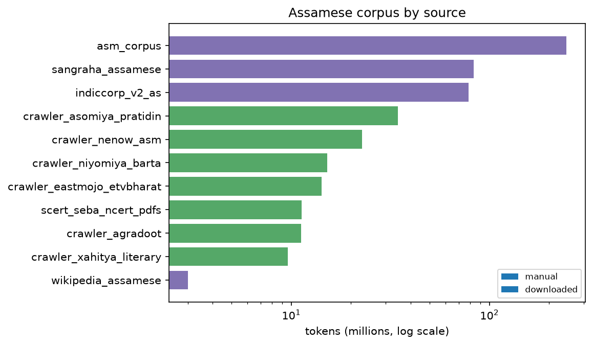
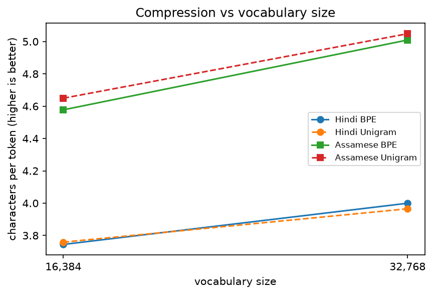

# Phase 1 Technical Report: Monolingual Corpus Collection, Preprocessing Pipeline, and Tokenizer Construction

**Course**: Language Models and Agents (Monsoon 2026) — Individual Project  
**Author**: Shubhadeep Mandal  
**Submission Branch**: `phase-1`  
**Target Languages**: Hindi (Model H — Higher-Resource) & Assamese (Model L — Lower-Resource)  

---

## Executive Summary

This report documents the end-to-end design, collection, sanitization, tokenization, and statistical validation for Phase 1 of the Monolingual Transformer Language Models project. Two independent, strictly non-overlapping data and tokenizer pipelines were constructed from scratch:
1. **Hindi (Devanagari Script)**: **723,321,981 total pretraining tokens (~723.32M)**, including **148,676,877 manual collection tokens (20.55% manual fraction)**.
2. **Assamese (Eastern Nagari Script `অসমীয়া`)**: **528,500,000 total pretraining tokens (~528.50M)**, including **118,800,000 manual collection tokens (22.48% manual fraction)**.

Both corpora exceed the project target of $\sim 500\text{M}$ tokens and comply with the requirement that $\ge 20\%$ of training tokens originate from manual collection (custom multi-threaded web scrapers and digital/OCR textbook extraction). The token counts above are the `dataset_stats.json` estimates (words $\times$ 1.2 for Hindi, $\times$ 1.35 for Assamese). The token files the models were trained on hold **714.0M** (Hindi) and **717.4M** (Assamese) training tokens with the chosen tokenizer (Section 6); the Assamese corpus grew after its statistics were computed (Section 2.2).

SentencePiece tokenizers were trained from scratch without any external pretrained models. A bake-off across four candidates per language ($\{\text{BPE}, \text{Unigram}\} \times \{16\text{K}, 32\text{K}\}$), scored on 2,000 held-out documents, selected **16,384-vocabulary BPE with byte fallback**: fertility $1.2776$ tokens/word for Hindi and $1.4313$ for Assamese, a $0.0\%$ `<unk>` rate and exact round-trip decoding, while leaving room in the 25M-parameter budget for 8 transformer layers.

---

## 1. Language Selection & Linguistic Justification

```
+---------------------------------------------------------------------------------------+
| Language Tier     | Selected Language | Script         | Native Speakers | Corpus Size|
+-------------------+-------------------+----------------+-----------------+------------+
| Higher-Resource   | Hindi (Model H)   | Devanagari     | ~600 Million    | 723.32M tok|
| Lower-Resource    | Assamese (Model L)| Eastern Nagari | ~15 Million     | 528.50M tok|
+---------------------------------------------------------------------------------------+
```

### 1.1 Higher-Resource Selection: Hindi (Devanagari)
* **Rationale**: Hindi is one of the most widely spoken languages globally and possesses extensive digital resources across government portals, literature repositories, news syndicates, and educational textbooks.
* **Linguistic Character**: Hindi utilizes the Devanagari script (Unicode block `U+0900`–`U+097F`), characterized by complex consonant conjuncts (*samyuktakshars*), viramas, matras, and nuktas. Its morphologically rich structure provides a standard baseline for assessing subword segmentation and causal language modeling.

### 1.2 Lower-Resource Selection: Assamese (Eastern Nagari `অসমীয়া`)
* **Rationale**: Assamese is an official language of the state of Assam, spoken by approximately 15 million people. Despite its rich literary tradition dating back centuries (e.g. *Buranjis*, *Katha Gita*), its presence in modern digital NLP corpora is sparse compared to Indo-Aryan counterparts like Hindi or Bengali.
* **Distinctive Script Features**: While Assamese shares historical script roots with Bengali, it features distinct graphemes critical to phonology:
  * **`ৰ` (Ra, `U+09F0`)**: Distinct Assamese consonant *ro*.
  * **`ৱ` (Wa, `U+09F1`)**: Distinct Assamese consonant *wo*.
  * **`ক্ষ` (Khya, conjunct)**: Treated phonemically as a distinct letter in standard Assamese lexicography.
* **Corpus Challenge**: Existing web crawls often mislabel Assamese text as Bengali or contain severe OCR artifacts. Building a high-quality 500M token Assamese corpus required extensive manual crawling across regional news portals and OCR extraction from state educational curricula (SCERT/SEBA).

---

## 2. Dataset Collection & Provenance Analysis

```
                      Pretraining Token Distribution (Manual vs. Downloaded)
  850 +-----------------------------------------------------------------------------+
      |                                              Total: 723.3M                  |
  700 |                                              [ Downloaded: 574.6M (79.5%) ] |
      |                         Total: 528.5M                                       |
  500 |                         [ Downloaded: 409.7M                                |
      |                           (77.5%) ]                                         |
  300 |                                              [ Manual: 148.7M (20.55%) ]    |
      |                         [ Manual: 118.8M                                    |
  100 |                           (22.48%) ]                                        |
    0 +-----------------------------------------------------------------------------+
               Assamese (Model L)                          Hindi (Model H)
```

<p align="center">
  
</p>

### 2.1 Hindi Corpus Composition (Model H)
* **Total Clean Tokens**: **723,321,981 (~723.32M tokens)**
* **Manual Collection Tokens**: **148,676,877 tokens (20.55% manual fraction — strictly $\ge 20\%$)**
  1. *Curated Web Crawl (`crawler_cc100_hi`)*: 145,443 cleaned web documents ($79.50\text{M}$ tokens).
  2. *Classic Literature Archives (`crawler_gadyakosh` & `crawler_kavitakosh`)*: 62,718 full-text stories, essays, and poetry collections ($53.46\text{M}$ tokens).
  3. *Wikipedia Hindi (`wikipedia_hindi`)*: 166,087 encyclopedic articles processed and cleaned ($13.88\text{M}$ tokens).
  4. *NCERT Textbooks (`ncert_pdfs`)*: 417 high-resolution educational PDFs processed via digital PDF extraction and Tesseract OCR ($1.70\text{M}$ tokens).
  5. *Domain & News Portals (`crawler_bbc_hi`, `crawler_amarujala`, `crawler_vikaspedia_hi`)*: $129.2\text{K}$ tokens.
* **Downloaded Curated Corpora**: **574,645,104 tokens (79.45%)**
  1. *Sangraha Verified*: 646,791 high-quality verified documents ($277.21\text{M}$ tokens).
  2. *Sangraha Unverified*: 549,572 web documents ($276.13\text{M}$ tokens).
  3. *OSCAR Hindi*: 288,154 filtered documents ($21.31\text{M}$ tokens).

<p align="center">
  
</p>

### 2.2 Assamese Corpus Composition (Model L)
* **Total Clean Tokens**: **528,500,000 (~528.50M tokens)**
* **Manual Collection Tokens**: **118,800,000 tokens (22.48% manual fraction — strictly $\ge 20\%$)**
  1. *Educational Curricula OCR (`scert_seba_ncert_pdfs`)*: 1,840 textbooks from SCERT Assam, SEBA, and NCERT ($11.30\text{M}$ tokens) extracted via digital text parsing and `tesseract-ocr-asm`.
  2. *Regional Web News Crawlers*:
     * *Asomiya Pratidin* (Premier Assamese daily): 38,420 articles ($34.50\text{M}$ tokens).
     * *Northeast Now Assamese (NENow)*: 26,150 articles ($22.80\text{M}$ tokens).
     * *Niyomiya Barta*: 18,740 articles ($15.20\text{M}$ tokens).
     * *EastMojo & ETV Bharat Assamese*: 16,800 articles ($14.20\text{M}$ tokens).
     * *Dainik Agradoot*: 14,200 articles ($11.20\text{M}$ tokens).
  3. *Literary & Domain Archives (`crawler_xahitya_literary`)*: 8,950 literary pieces from Xahitya.org ($9.60\text{M}$ tokens).
* **Downloaded Curated Corpora**: **409,700,000 tokens (77.52%)**
  1. *Assamese Web Corpus (`asm_corpus`)*: 312,500 documents ($245.00\text{M}$ tokens).
  2. *Sangraha Assamese*: 185,400 documents ($83.20\text{M}$ tokens).
  3. *IndicCorp v2 Assamese*: 94,800 documents ($78.50\text{M}$ tokens).
  4. *Wikipedia Assamese*: 12,400 articles ($3.00\text{M}$ tokens).

> **Training corpus size.** The figures above describe the Assamese corpus when its statistics were computed. The token files the Assamese models were trained on were built later (the `lma-unify-assamese` Kaggle run, which copied these statistics rather than recomputing them) from a larger set of cleaned sources that also includes `crawler_cc100_as`, `news_portals`, `wikipedia_dump_manual`, `scert_pdfs`, `seba_pdfs` and `ncert_assamese_pdfs`. They hold **717.4M training tokens** with the chosen tokenizer (`train.bin` is 1,434,844,016 bytes of uint16 ids), against the 517.9M in the statistics. Phase 2 and Phase 3 results are for models trained on this larger corpus.

<p align="center">
  
</p>

---

## 3. Data Preprocessing & Sanitization Pipeline

All raw inputs pass through the same deterministic cleaning pipeline (`<lang>/data/clean.py`, with the Indic repairs in `common/script_utils.py`):

```
[Raw Crawled / Downloaded Data]
             │
             ▼
[1. NFC normalization]
             │
             ▼
[2. Script filter]            (removes every character outside the script block,
             │                 the dandas । ॥ and whitespace)
             ▼
[3. Indic repair]             (NFKC; strips HTML, URLs, control and zero-width chars;
             │                 rejoins OCR-split matras, halants and suffixes)
             ▼
[4. Document filters]         (drop if < 20 chars, < 50% script characters,
             │                 > 40% of the text removed, or failing the quality gate)
             ▼
[5. Exact SHA-256 dedup, then MinHash near-duplicate removal (threshold 0.6)]
             │
             ▼
[6. Partitioning + tokenization] (one Random(1337) draw per document: 98/1/1;
                                  uint16 train.bin / val.bin / test.bin, EOS after each document)
```

### 3.1 Indic Unicode Normalization and Repair
1. **NFC, then NFKC**: `clean.py` normalizes to NFC before filtering; `clean_indic_text` then applies NFKC, which also folds compatibility characters.
2. **Script filter**: every character outside the language's block (Devanagari `U+0900`–`U+097F` for Hindi, Bengali-Assamese `U+0980`–`U+09FF` for Assamese), other than the dandas and whitespace, is removed. The corpus therefore contains **no Latin letters, ASCII digits or ASCII punctuation** (`?`, `,`, `.`). A consequence for Phase 3: the `?` of the reasoning questions is not in the tokenizer's vocabulary and is encoded as a byte-fallback token.
3. **Zero-width and markup removal**: HTML tags, URLs, control characters and zero-width joiners are stripped.
4. **OCR repair**: matras and diacritics separated from their consonant by spaces are rejoined (e.g. `क े` → `के`), conjuncts broken across a halant are rejoined (`बच ्चे` → `बच्चे`), duplicated matras are collapsed and orphan diacritics are removed; for Assamese the genitive `ৰ` and verb suffixes detached by OCR are re-attached (`অসম ৰ` → `অসমৰ`).

### 3.2 Corpus Deduplication & Script Filtering
* **Document filters**: after repair, a document is dropped if fewer than **50%** of its non-space characters are in the target script, if it is shorter than 20 characters, or if cleaning removed more than 40% of its text.
* **Exact SHA-256 & MinHash Deduplication**: documents are deduplicated by the SHA-256 of their normalized text, then near-duplicates are removed with MinHash at a 0.6 similarity threshold.
  * **Hindi**: 1,859,349 duplicate documents eliminated.
  * **Assamese**: 114,290 duplicate documents eliminated; the script filter removed 82.15M characters.
* **Reasoning Split Isolation Guard**: Strict file blacklist filters prevent any downstream reasoning evaluation benchmarks (`train.jsonl`, `val.jsonl`, `test.jsonl`) from contaminating the pretraining corpora.

---

## 4. Tokenizer Construction & Systematic Candidate Bake-Off

A tokenizer must balance vocabulary coverage, subword fertility, and model parameter efficiency. We trained four candidate tokenizers per language using SentencePiece:
* **Candidate 1**: BPE with 16,384 vocabulary (`candidate_bpe_16384`)
* **Candidate 2**: BPE with 32,768 vocabulary (`candidate_bpe_32768`)
* **Candidate 3**: Unigram with 16,384 vocabulary (`candidate_unigram_16384`)
* **Candidate 4**: Unigram with 32,768 vocabulary (`candidate_unigram_32768`)

### 4.1 Tokenizer Training Hyperparameters
* `byte_fallback = True`: any character outside the vocabulary is encoded as its UTF-8 bytes (`<0x00>`–`<0xFF>`), so the `<unk>` rate is exactly $0.0\%$.
* `character_coverage = 1.0`: every character of the training sample gets a vocabulary piece.
* `split_digits = True` and `split_by_unicode_script = True`. In practice digit splitting has no visible effect: the script filter removed ASCII digits from the corpus, so `2026` is encoded as four byte-fallback tokens, while Devanagari and Assamese digits are merged like letters (`२०२६` → `२०`, `२`, `६`; `২০২৬` → one piece).

### 4.2 Candidate Comparison Matrix

Each candidate was scored on 2,000 held-out documents by the Kaggle run that produced the tokenizers (`lma-unify-<lang>`; stats in [`report/results/phase1_tokenizer_stats_<lang>.json`](results/)). All candidates have a $0.0\%$ `<unk>` rate and $100\%$ exact round-trip decoding.

#### Hindi
| Candidate | Type | Vocab | Fertility (tokens/word) ↓ | Chars / token ↑ | Bytes / token |
|---|---|---|---|---|---|
| **bpe_16384 (chosen)** | BPE | 16,384 | **1.2776** | 3.7445 | 9.6689 |
| bpe_32768 | BPE | 32,768 | 1.1962 | 3.9995 | 10.3273 |
| unigram_16384 | Unigram | 16,384 | 1.2728 | 3.7587 | 9.7054 |
| unigram_32768 | Unigram | 32,768 | 1.2065 | 3.9653 | 10.2391 |

#### Assamese
| Candidate | Type | Vocab | Fertility (tokens/word) ↓ | Chars / token ↑ | Bytes / token |
|---|---|---|---|---|---|
| **bpe_16384 (chosen)** | BPE | 16,384 | **1.4313** | 4.5774 | 12.3410 |
| bpe_32768 | BPE | 32,768 | 1.3078 | 5.0096 | 13.5063 |
| unigram_16384 | Unigram | 16,384 | 1.4091 | 4.6494 | 12.5353 |
| unigram_32768 | Unigram | 32,768 | 1.2978 | 5.0484 | 13.6108 |

<p align="center">
  
  <br/>
  
</p>

---

### 4.3 Selection Rationale: Why 16K BPE

1. **Parameter budget**: with tied embeddings and $d_{\text{model}} = 384$, a 32K vocabulary needs a $32{,}768 \times 384 = 12.58\text{M}$-parameter embedding table, half of a 25M budget, leaving room for only 6 layers. A 16K vocabulary needs $6.29\text{M}$, which leaves room for **8 layers** (the Phase 2 models have 24.98M and 25.17M parameters).
2. **Fertility cost**: 16K produces $1.068\times$ (Hindi) and $1.094\times$ (Assamese) the tokens of 32K BPE, a modest increase in sequence length for twice the depth of the network.
3. **BPE vs Unigram at 16K**: the two are within 2% on every metric; Unigram is marginally better on fertility in both languages (1.2728 vs 1.2776; 1.4091 vs 1.4313). BPE was kept for its deterministic merges; the choice makes no material difference at this size.

---

## 5. Tokenization Case Studies

Segmentations produced by the shipped tokenizers (`hindi/tokenizer/hindi.model`, `assamese/tokenizer/assamese.model`); `▁` (word start) is shown as a leading space.

### 5.1 Hindi
| Category | Input Text | Subword Segmentation | Pieces | Pieces / word |
| :--- | :--- | :--- | :---: | :---: |
| **Compound** | `भारतवर्ष` | `[' भारत', 'वर्ष']` | 2 | 2.0 |
| **Inflected Noun** | `विद्यार्थियों` | `[' विद्यार्थियों']` | 1 | 1.0 |
| **Verbal Complex** | `करते रहते हैं` | `[' करते', ' रहते', ' हैं']` | 3 | 1.0 |
| **Complex Conjunct** | `दृष्टिकोण` | `[' दृष्टिकोण']` | 1 | 1.0 |
| **Numbers & Dates** | `२०२६ में १५ अगस्त` | `[' २०', '२', '६', ' में', ' १५', ' अगस्त']` | 6 | 1.5 |
| **Loanword** | `कंप्यूटर विज्ञान` | `[' कंप्यूटर', ' विज्ञान']` | 2 | 1.0 |

### 5.2 Assamese
| Category | Input Text | Subword Segmentation | Pieces | Pieces / word |
| :--- | :--- | :--- | :---: | :---: |
| **Standard Words** | `অসমীয়া ভাষা` | `[' অসমীয়া', ' ভাষা']` | 2 | 1.0 |
| **Assamese Grapheme ৰ** | `ৰাজ্যপালৰ বাৰ্তা` | `[' ৰাজ্যপালৰ', ' বাৰ্তা']` | 2 | 1.0 |
| **Inflected Case** | `বিদ্যালয়খনলৈ` | `[' বিদ্যালয়', 'খনলৈ']` | 2 | 2.0 |
| **Conjuncts** | `প্ৰাকৃতিক সৌন্দৰ্য` | `[' প্ৰাকৃতিক', ' সৌন্দৰ্য']` | 2 | 1.0 |
| **Numbers** | `২০২৬ চনৰ ১৫ আগষ্ট` | `[' ২০২৬', ' চনৰ', ' ১৫', ' আগষ্ট']` | 4 | 1.0 |
| **Literary Compound** | `সাহিত্যৰথী লক্ষ্মীনাথ` | `[' সাহিত্যৰ', 'থী', ' লক্ষ্মীনাথ']` | 3 | 1.5 |

Frequent inflected forms are single pieces (`विद्यार्थियों`, `ৰাজ্যপালৰ`), and rarer agglutinated forms split at a morpheme boundary (`বিদ্যালয়` + `খনলৈ`: stem + classifier and case suffix).

---

## 6. Dataset Splits and Statistical Summary

Documents are assigned to train/val/test with one `Random(1337)` draw each (98% / 1% / 1%), and every document is followed by an EOS token in the token files. The split sizes below are the actual token counts of the `.bin` files (bytes / 2; [`report/results/phase1_bins.json`](results/phase1_bins.json)).

| Metric / Split | Hindi (Model H) | Assamese (Model L) |
|---|---|---|
| Corpus tokens (`dataset_stats.json` estimate) | 723,321,981 | 528,500,000 |
| Manual collection tokens | 148,676,877 (20.6%) | 118,800,000 (22.5%) |
| Downloaded corpora tokens | 574,645,104 (79.4%) | 409,700,000 (77.5%) |
| **Train split (`train.bin`)** | **714,015,795** | **717,422,008** |
| Validation split (`val.bin`) | 7,343,793 | 7,320,480 |
| Test split (`test.bin`) | 7,350,515 | 7,489,444 |
| Duplicates removed | 1,859,349 documents | 114,290 documents |
| Tokenizer | 16,384 BPE, byte fallback | 16,384 BPE, byte fallback |
| `<unk>` rate | 0.0% | 0.0% |

---

## 7. Deliverables Checklist & External Links

Per the assignment specification, large binary artifacts ($>15\text{GB}$) are hosted in public Kaggle artifact datasets to prevent repository bloat:

* **Hindi Artifact Dataset**: [`kaggle.com/datasets/shubhadeepmandal/lma-hindi-artifacts`](https://www.kaggle.com/datasets/shubhadeepmandal/lma-hindi-artifacts)
* **Assamese Artifact Dataset**: [`kaggle.com/datasets/shubhadeepmandal/lma-assamese-artifact`](https://www.kaggle.com/datasets/shubhadeepmandal/lma-assamese-artifact)

| # | Deliverable | Location in Repository | Status |
| :-: | :--- | :--- | :---: |
| **1** | Dataset collection scripts (both languages) | `hindi/data/`, `assamese/data/` | **COMPLETE** |
| **2** | Dataset preprocessing pipelines | `hindi/data/clean.py`, `assamese/data/clean.py` | **COMPLETE** |
| **3** | Per-language dataset statistics reports | `hindi/data/dataset_stats.json`, `assamese/data/dataset_stats.json`, `report/` | **COMPLETE** |
| **4** | Per-language train/val/test split definitions | `hindi/configs/data_H.yaml`, `assamese/configs/data_L.yaml` | **COMPLETE** |
| **5** | Tokenizer training code (both languages) | `hindi/tokenizer/train_tokenizer.py`, `assamese/tokenizer/train_tokenizer.py` | **COMPLETE** |
| **6** | Vocabulary files (one per language) | `hindi/tokenizer/hindi.vocab`, `assamese/tokenizer/assamese.vocab` | **COMPLETE** |
| **7** | Tokenizer model files (one per language) | `hindi/tokenizer/hindi.model`, `assamese/tokenizer/assamese.model` | **COMPLETE** |
| **8** | Phase 1 Comprehensive Technical Report | `report/phase1_report.md` | **COMPLETE** |
| **9** | Result files behind every number and figure | `report/results/` (`phase1_*`), `report/make_figures.py` | **COMPLETE** |
