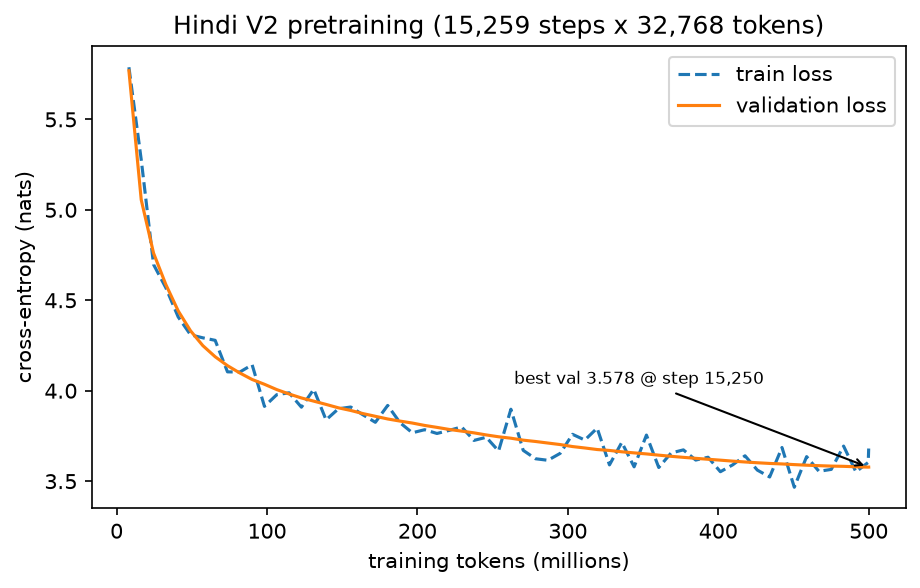
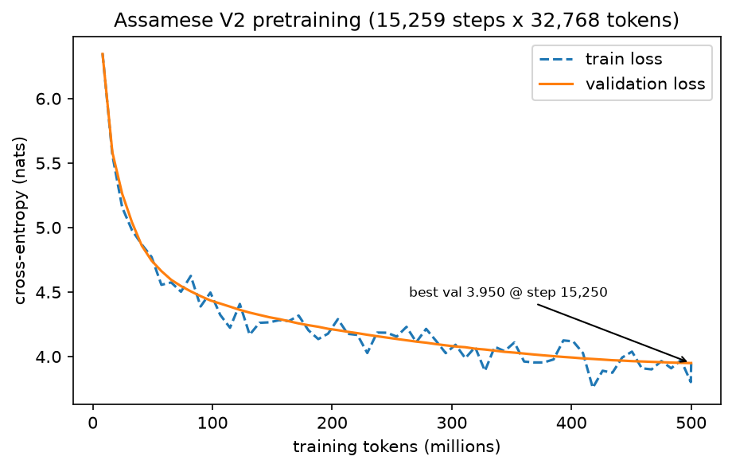
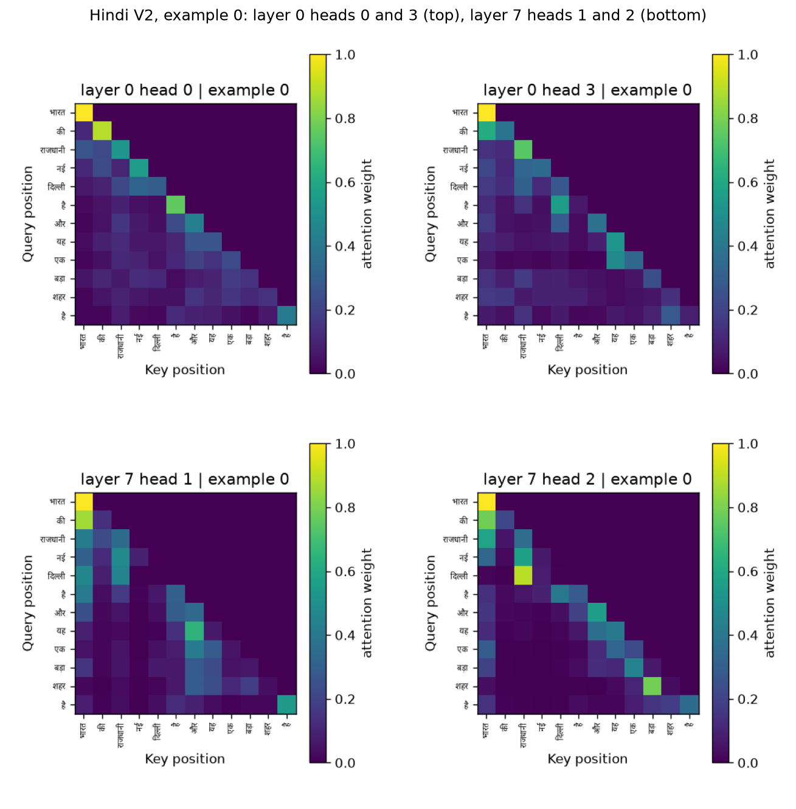
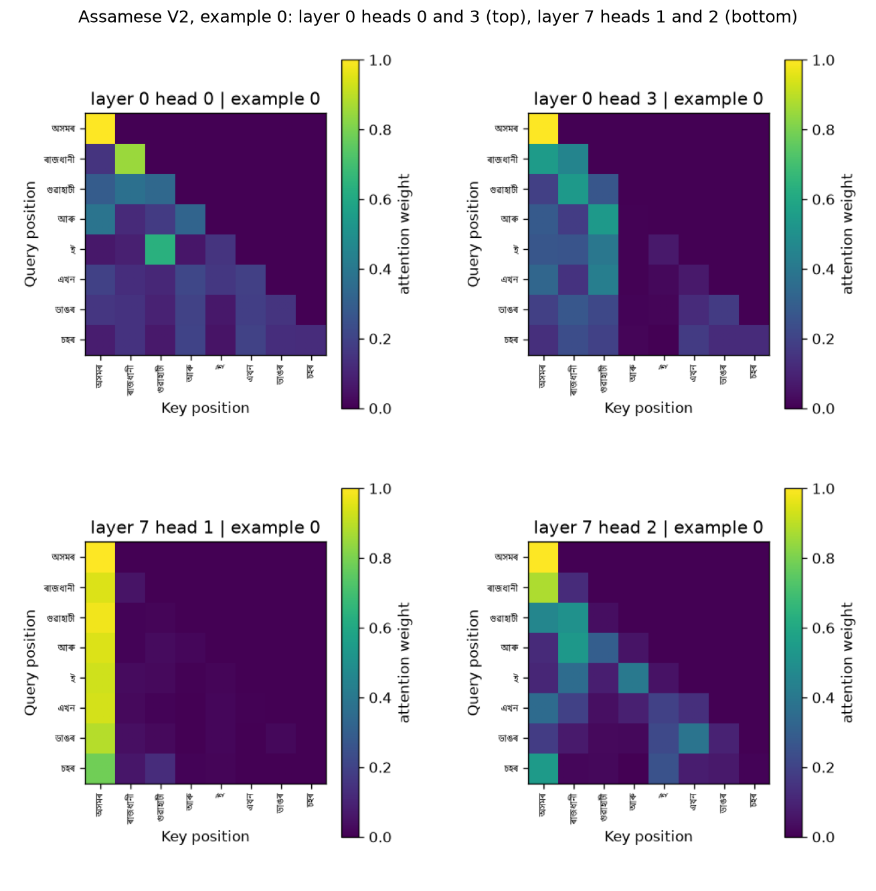
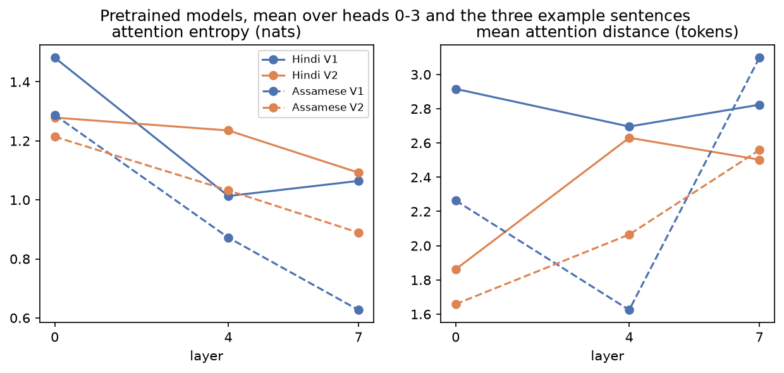

# Phase 2 Technical Report — 16K Transformer LM Pretraining & Evaluation (40 marks)

**Course:** Language Models and Agents (Monsoon 2026)  
**Author:** Shubhadeep Mandal  
**Target Languages:** Model H = Hindi (Devanagari script) · Model L = Assamese (Eastern Nagari script `অসমীয়া`)  
**Models:** two ~25M-parameter architectures per language, each pretrained on 500M tokens (15,259 steps × 32,768 tokens)

Every number in this report is read from the result files in [`report/results/`](results/) (copied unchanged from the Kaggle runs listed in [`report/results/README.md`](results/README.md)), and every figure is drawn from them by [`report/make_figures.py`](make_figures.py).

---

## Executive Summary

Two 8-layer decoder-only Transformers were implemented from PyTorch primitives and pretrained from scratch in each language with the Phase 1 16K BPE tokenizers:

| Language | Architecture | Params | Best val loss (PPL) | Test loss, 512-token windows (PPL) | Test BPB |
|---|---|---|---|---|---|
| Hindi | Baseline V1 | 24,982,272 | 3.6260 (37.56) | 3.6547 (38.66) | 0.4856 |
| Hindi | **Modern V2** | 25,172,352 | **3.5775 (35.79)** | **3.5876 (36.15)** | **0.4767** |
| Assamese | Baseline V1 | 24,982,272 | 3.9966 (54.41) | 3.9987 (54.53) | 0.4634 |
| Assamese | **Modern V2** | 25,172,352 | **3.9496 (51.91)** | **3.9425 (51.55)** | **0.4569** |

* **Modern V2 is better in both languages, by a small margin**: 0.067 nats (6.5% lower perplexity) in Hindi and 0.056 nats (5.5%) in Assamese on the full-context test windows, with matched data, budget and schedule. Both architectures train smoothly with no instability.
* **Assamese has higher token perplexity but slightly lower bits per byte** than Hindi (0.457 vs 0.477 for V2), so per byte of text the Assamese model is not worse; the token-level gap reflects Assamese's longer tokens (4.58 vs 3.74 characters per token).
* **Generation**: greedy decoding loops (3-gram repetition 0.73–0.77); sampling at T = 1.0 or nucleus sampling removes the loops. V1 and V2 generate text of near-identical quality on every metric.
* Neither architecture dominates downstream: in Phase 3, V1 learned the reasoning task better than V2 in both languages.

---

## 1. Architectures (Deliverable 1)

Both models are implemented independently in [`hindi/model/`](../hindi/model/) and [`assamese/model/`](../assamese/model/) (`gpt.py` = V1, `gpt_v2.py` = V2), with no cross-language imports or shared weights. Common settings: 8 layers, $d_{\text{model}} = 384$, 6 heads ($d_k = 64$), 512-token context, 16,384-token vocabulary, tied input/output embeddings, dropout 0.

```
                         Input Token IDs (B, T)
                                   │
                    ┌──────────────┴──────────────┐
                    ▼                             ▼
          [Baseline V1 flow]             [Modern V2 flow]
      Token emb + learned pos (512)      Token emb (no additive position)
                    │                             │
        ┌───────────┴───────────┐     ┌───────────┴───────────┐
        │  Block × 8 (Pre-LN)   │     │ Block × 8 (Pre-RMSNorm)│
        │  - Manual causal MHA  │     │ - RoPE on Q, K         │
        │  - GELU FFN (d=2240)  │     │ - SwiGLU FFN (d=1536)  │
        │  - LayerNorm          │     │ - SDPA attention       │
        └───────────┬───────────┘     └───────────┬───────────┘
             Final LayerNorm                Final RMSNorm
                    │                             │
          Tied output head (16K)        Tied output head (16K)
```

### 1.1 Baseline V1
- **Input:** token embeddings ($16{,}384 \times 384$) plus learned absolute position embeddings ($512 \times 384$).
- **Attention:** explicit upper-triangular causal mask, $\text{softmax}(QK^\top / \sqrt{64} + M)V$ computed by hand.
- **FFN:** $384 \to 2240 \to 384$ with GELU; Pre-LN LayerNorm before each sublayer.
- **Parameters:** embeddings 6,291,456 + positions 196,608 + 8 blocks × 2,310,912 + final LayerNorm 768 = **24,982,272**.

### 1.2 Modern V2
- **Input:** token embeddings only; Rotary Position Embeddings ($\theta = 10{,}000$) rotate queries and keys in every layer.
- **Attention:** PyTorch `scaled_dot_product_attention` with its causal mask.
- **FFN:** SwiGLU, $\text{SwiGLU}(x) = (\text{silu}(xW_{\text{gate}}) \odot xW_{\text{up}})W_{\text{down}}$, inner dimension 1536; RMSNorm instead of LayerNorm.
- **Parameters:** embeddings 6,291,456 + 8 blocks × 2,359,680 + final RMSNorm 384 = **25,172,352**.

Both counts are within the 22.5M–27.5M window and were confirmed by instantiating the shipped configs.

### 1.3 Causality Check
Changing tokens $64 \ldots 127$ of a 128-token input leaves the logits at positions $0 \ldots 63$ bit-identical ($\max |\Delta\text{logits}| = 0.0$) for both architectures, while later positions change (max difference 2.2 for V1, 3.1 for V2): no future token reaches an earlier position.

---

## 2. Pretraining Protocol & Convergence (Deliverables 3–4)

Configuration ([`hindi/configs/train_H.yaml`](../hindi/configs/train_H.yaml); the Assamese file is identical):

| Setting | Value |
|---|---|
| Optimizer | AdamW, $\beta = (0.9, 0.95)$, weight decay 0.1, gradient clipping at norm 1.0 |
| Learning rate | $6 \times 10^{-4}$, 300 warmup steps, cosine decay to $6 \times 10^{-5}$ |
| Batch | 64 sequences × 512 tokens = 32,768 tokens per step |
| Duration | 15,259 steps = **500.0M tokens** (0.70 of an epoch over each `train.bin`) |
| Precision | fp16 mixed precision (`torch.cuda.amp`) |
| Validation | every 250 steps; `best.pt` keeps the lowest validation loss |

Runs: `seronic2001/lma-pretrain-{hindi,assamese}-v1` and `shubhadeepmandal/lma-pretrain-{hindi,assamese}-v2` on Kaggle (training logs: [`report/results/phase2_train_log_*.json`](results/)).

| Run | Val loss @ step 250 | Best val loss | Best step | Final val loss (step 15,259) |
|---|---|---|---|---|
| Hindi V1 | 6.0773 | 3.6260 | 15,250 | 3.6262 |
| Hindi V2 | 5.7688 | **3.5775** | 15,250 | 3.5777 |
| Assamese V1 | 6.6581 | 3.9966 | 15,259 | 3.9966 |
| Assamese V2 | 6.3454 | **3.9496** | 15,250 | 3.9498 |

Validation loss was still decreasing at the end of every run (best at or within 9 steps of the last step), so all four models are compute-limited, not converged: more tokens would lower the loss further.

<p align="center">
  
  <br/>
  
  <br/>
  <em>Figures 1–2: training (dashed) and validation (solid) loss of the V2 models over 500M tokens.</em>
</p>

### 2.1 Architecture Comparison

<p align="center">
  
  <br/>
  
  <br/>
  <em>Figures 3–4: validation loss of Baseline V1 and Modern V2. V2 leads from the first evaluation and the gap narrows from ~0.3 nats early in training to ~0.05 nats at the end.</em>
</p>

V2's advantage is largest early in training (0.31 nats at step 250 in both languages) and shrinks to 0.049 (Hindi) and 0.047 (Assamese) nats by the end. The modern components mainly speed up learning; at this scale and budget their final advantage is about 5–7% in perplexity.

---

## 3. Intrinsic Evaluation: Perplexity & Bits per Byte (Deliverable 5a)

Two held-out measurements on `test.bin` (never seen in training or checkpoint selection):

* **Full context** (headline numbers): 2,000 evenly spaced, non-overlapping 512-token windows (1,022,000 predicted tokens). The windows are fixed, so all four models are scored on identical text.
* **Short context**: 500 windows of 96 tokens (the 32-token prompt + 64-token continuation of the generation protocol; 47,500 predicted tokens), stored in [`<lang>/eval/ppl_bpb_table.json`](../hindi/eval/ppl_bpb_table.json).

| Language | Model | Full-context loss | Full-context PPL | Full-context BPB | Short-context loss | Short-context PPL | Short-context BPB |
|---|---|---|---|---|---|---|---|
| Hindi | V1 | 3.6547 | 38.66 | 0.4856 | 3.8138 | 45.32 | 0.4998 |
| Hindi | **V2** | **3.5876** | **36.15** | **0.4767** | **3.7396** | **42.08** | **0.4901** |
| Assamese | V1 | 3.9987 | 54.53 | 0.4634 | 4.2326 | 68.90 | 0.4845 |
| Assamese | **V2** | **3.9425** | **51.55** | **0.4569** | **4.1705** | **64.75** | **0.4774** |

$$\text{BPB} = \frac{\mathcal{L}_{\text{CE}}}{\ln 2} \times \frac{\text{predicted tokens}}{\text{UTF-8 bytes of those tokens}}$$

**Loss by amount of preceding context** (full-context windows, nats):

| Model | 1–31 tokens | 32–95 | 96–255 | 256–511 |
|---|---|---|---|---|
| Hindi V1 | 4.172 | 3.734 | 3.619 | 3.595 |
| Hindi V2 | 4.116 | 3.659 | 3.551 | 3.529 |
| Assamese V1 | 4.507 | 4.073 | 3.979 | 3.931 |
| Assamese V2 | 4.451 | 4.014 | 3.922 | 3.876 |

### Observations
1. **Context helps up to the end of the window.** Loss falls by ~0.6 nats from the first 31 tokens to positions 256–511 in every model, and is still falling in the last bucket: both architectures use long context. V2 is better at every context length by a near-constant 0.05–0.07 nats, so its advantage is not specific to long-range positions.
2. **The short-context numbers are worse** (e.g. 42.08 vs 36.15 for Hindi V2) because every 96-token window starts without context; they are reported for comparability with the generation protocol.
3. **Hindi vs Assamese.** Assamese token perplexity is higher (51.6 vs 36.2 for V2), but its BPB is lower (0.457 vs 0.477). An Assamese token covers more text (4.58 vs 3.74 characters, Phase 1), so each prediction is harder while the cost per byte of text is similar or lower. On this evidence the lower-resource Assamese model is not a weaker compressor of its language.

---

## 4. Generation Quality and Diversity (Deliverables 5b–6)

Protocol ([`<lang>/eval/evaluate.py`](../hindi/eval/evaluate.py)): 500 held-out 32-token prefixes from `test.bin`, a 64-token continuation at temperatures 0.0 (greedy), 0.5, 1.0 and 1.5, plus a nucleus row (T = 0.8, top-p 0.9, repetition penalty 1.15), each compared with the true 64-token continuation. The V2 outputs are in [`<lang>/eval/generation_metrics.json`](../hindi/eval/generation_metrics.json) and [`generated_samples.jsonl`](../hindi/eval/generated_samples.jsonl); all four models in [`report/results/phase2_pretrained_eval.json`](results/phase2_pretrained_eval.json).

| Model | Decoding | BLEU-4 | chrF | ROUGE-L | Rep-3 ↓ | Distinct-1 | Distinct-2 |
|---|---|---|---|---|---|---|---|
| Hindi V1 | greedy | 1.66 | 15.99 | 0.112 | 0.769 | 0.058 | 0.166 |
| | T = 1.0 | 0.78 | 20.05 | 0.105 | 0.031 | 0.270 | 0.801 |
| | nucleus | 1.35 | **21.15** | 0.116 | 0.082 | 0.170 | 0.656 |
| Hindi V2 | greedy | 1.74 | 16.30 | 0.114 | 0.735 | 0.063 | 0.187 |
| | T = 0.5 | **2.14** | 19.04 | **0.126** | 0.365 | 0.104 | 0.406 |
| | T = 1.0 | 0.55 | 20.01 | 0.105 | 0.029 | 0.270 | 0.803 |
| | T = 1.5 | 0.05 | 18.19 | 0.044 | 0.000 | 0.515 | 0.991 |
| | nucleus | 1.64 | 21.07 | 0.116 | 0.079 | 0.171 | 0.658 |
| Assamese V1 | greedy | 3.29 | 17.55 | 0.070 | 0.764 | 0.089 | 0.188 |
| | T = 1.0 | 3.43 | 23.19 | 0.072 | 0.040 | 0.423 | 0.897 |
| | nucleus | 3.65 | 24.09 | 0.082 | 0.054 | 0.315 | 0.814 |
| Assamese V2 | greedy | 3.38 | 18.70 | 0.075 | 0.726 | 0.094 | 0.211 |
| | T = 0.5 | 3.74 | 21.75 | **0.086** | 0.261 | 0.197 | 0.555 |
| | T = 1.0 | 3.65 | 23.30 | 0.074 | 0.039 | 0.429 | 0.903 |
| | T = 1.5 | 0.94 | 20.31 | 0.026 | 0.004 | 0.580 | 0.992 |
| | nucleus | **3.81** | **24.33** | 0.085 | 0.055 | 0.321 | 0.815 |

### 4.1 Which metrics are informative here
* **BLEU-4 is nearly uninformative.** An open-ended continuation has many valid paths; matching four consecutive words of one reference is rare (BLEU 0.05–3.8). It is highest at T = 0.5 or with nucleus sampling, where outputs stay close to the most likely phrasing without looping.
* **chrF is the most useful reference metric.** Character n-grams credit shared stems despite different inflections, which matters for case-marked Hindi and agglutinative Assamese. It ranks decoding settings sensibly: lowest for greedy (loops), highest for nucleus sampling, falling again at T = 1.5.
* **ROUGE-L** rewards shared word order and peaks at T = 0.5. It is computed with a Unicode-aware tokenizer in [`common/metrics.py`](../common/metrics.py); the default `rouge_score` tokenizer drops non-ASCII text and returns 0.
* **Repetition and distinct-n** measure fluency failures the reference metrics miss: greedy decoding repeats 73–77% of its 3-grams; T = 1.0 brings this to 3–4% but T = 1.5 produces near-random word sequences (distinct-2 ≈ 0.99, chrF falls).

**Best setting:** nucleus sampling (T = 0.8, top-p 0.9, repetition penalty 1.15) has the highest chrF in all four models with only 5–8% repeated 3-grams.

**V1 vs V2:** the two architectures are within 1.2 chrF points of each other at every setting; the 6% perplexity gap does not produce a visible difference in sampled text.

### 4.2 Samples (Modern V2, held-out test prefixes)

**Hindi** — prefix: `अख़बारों और टेलीविज़न चैनलों ने उनके काम करने को तरीके को मान लिया है जैसा कि इंदिरा गांधी के वक़्त में कर लिया था हालांकि नरेंद्र मोदी का एकछ`  
* Reference: `त्र राज इस मामले में और बदतर हो गया है कि बीजेपी सरकार के किसी भी कैबिनेट मंत्री की कोई अहमियत नहीं रह गई है…`
* Greedy: `त्र राज था लेकिन इंदिरा गांधी के समय में ही उन्हें प्रधानमंत्री पद का उम्मीदवार घोषित कर दिया गया था इंदिरा गांधी के बाद इंदिरा गांधी का नाम भी इंदिरा गांधी के नाम पर ही रखा गया था…`  
  It completes the split word (`एकछ` + `त्र राज`, as in the reference) and stays on topic, then starts repeating `इंदिरा गांधी`.
* T = 1.0: `त्र रोमेंट शुरू से देखने को मिल रहा है ये मुनाफा घरेलू उपभोक्ताओं की नीलामी को हुई करोड़ रुपये सनसनीखेज कहा…`  
  Fluent local grammar and news vocabulary, but the topic drifts and the word completion is wrong.

**Assamese** — prefix: `শ্রীকৃষ্ণই নিজেই অনন্তব্ৰহ্মাণ্ডৰ স্রষ্টা পালন কৰোঁতা। ব্রহ্মাদি দেৱতাসকল তেওঁৰেই সৃষ্টি । নাৰায়ণৰূপে তেওঁ অনন্ত শ`  
* Reference: `য্যাত জলত শয়ন কৰে আৰু তেওঁৰ নাভিপদ্মৰ পৰাই ব্রহ্মা জাত হৈছে…`
* Greedy: `য্যাত বাস কৰে। তেওঁ অনন্ত শয্যাত বাস কৰে। তেওঁ অনন্ত শয্যাত বাস কৰে। অনন্ত শয্যাত বাস কৰে…`  
  Correct completion (`অনন্ত শয্যাত`, Vishnu's serpent bed, as in the reference), then a loop.
* T = 0.5: `য্যাত আছে। তেওঁ ব্ৰহ্মাৰূপে জন্মগ্ৰহণ কৰি তেওঁ ব্ৰহ্মাৰূপে প্ৰতিষ্ঠিত হয়…`  
  Stays in the mythological register with correct verb morphology, but repeats `ব্ৰহ্মাৰূপে`.

Both models have learned word-internal completion, topical vocabulary and local morphology; they do not keep a coherent argument beyond a sentence or two, as expected at 25M parameters and 500M tokens.

---

## 5. Attention Pattern Analysis (Deliverable 7)

Heatmaps of layers 0, 4 and 7 (heads 0–3) for three short sentences per language, from [`<lang>/eval/attention_analysis.py`](../hindi/eval/attention_analysis.py) on the V2 checkpoints, are in [`hindi/eval/attention/`](../hindi/eval/attention/) and [`assamese/eval/attention/`](../assamese/eval/attention/). Token labels use bundled Noto Sans Devanagari / Bengali fonts ([`common/plot_fonts.py`](../common/plot_fonts.py)), since Matplotlib's default font has neither script.

<p align="center">
  
  <br/>
  
  <br/>
  <em>Figures 5–6: V2 attention on example 0 (Hindi: भारत की राजधानी नई दिल्ली है और यह एक बड़ा शहर है; Assamese: অসমৰ ৰাজধানী গুৱাহাটী আৰু ই এখন ডাঙৰ চহৰ). Top: layer 0, heads 0 and 3. Bottom: layer 7, heads 1 and 2.</em>
</p>

Patterns visible in the heatmaps:
* **Layer 0 is local.** Most weight falls on the current token and the one or two before it (a near-diagonal band): word-internal and adjacent-word composition.
* **Later layers mix a first-token sink with content links.** Many layer-7 rows put a large share of their weight on the first token, a common "attention sink" in causal models, while individual heads link related words: in Hindi layer 7 head 2, `दिल्ली` (Delhi) attends mostly to `राजधानी` (capital), and `शहर` (city) to `बड़ा` (big).

Entropy and distance (mean over heads 0–3 and the three sentences; [`report/results/phase2_attention_summary_*.json`](results/)):

| Model | Layer 0 entropy | Layer 4 | Layer 7 | Layer 0 distance | Layer 4 | Layer 7 |
|---|---|---|---|---|---|---|
| Hindi V1 | 1.48 | 1.01 | 1.06 | 2.92 | 2.70 | 2.82 |
| Hindi V2 | 1.28 | 1.24 | 1.09 | 1.86 | 2.63 | 2.50 |
| Assamese V1 | 1.29 | 0.87 | 0.63 | 2.26 | 1.62 | 3.10 |
| Assamese V2 | 1.21 | 1.03 | 0.89 | 1.66 | 2.07 | 2.56 |

<p align="center">
  
</p>

Attention becomes sharper with depth in all four models (entropy falls from layer 0 to layer 7), and V2's layer-0 attention is more local than V1's (distance 1.7–1.9 vs 2.3–2.9 tokens), consistent with RoPE encoding relative position directly in the attention scores. These sentences are 8–12 tokens long, so the distances are small in absolute terms and the statistics are indicative only; Phase 3 measures attention on 200 longer reasoning prompts.

---

## 6. Implementation Checks

1. **Causality** (Section 1.3): future tokens do not affect earlier logits in either architecture.
2. **Parameter accounting**: instantiating the configs gives 24,982,272 (V1) and 25,172,352 (V2) parameters with tied embeddings.
3. **Checkpoint integrity**: every evaluation rebuilds the model from the configuration stored in the checkpoint, so the evaluated architecture is exactly the trained one; the evaluated `best.pt` files are from steps 15,250–15,259 of 15,259.

---

## 7. Model Choice for Phase 3

Modern V2 has the better language model in both languages, by 5–7% in perplexity. Because the margin is small, **both architectures were carried into Phase 3**: the reasoning experiments fine-tune V1 and V2 in each language. There the ranking reverses (Phase 3 report): V1 reaches 0.945 test relation accuracy in Hindi against 0.880 for V2. Pretraining perplexity was not a good predictor of how well a model learns the reasoning task.
