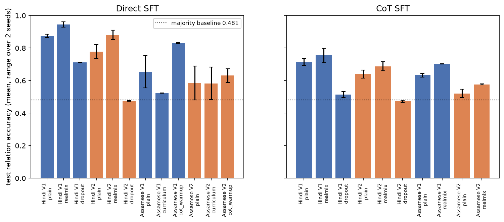
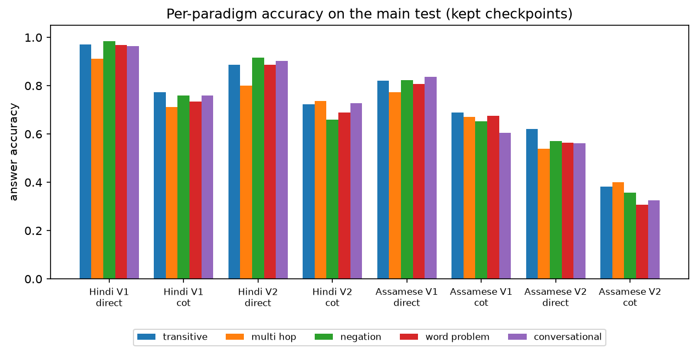
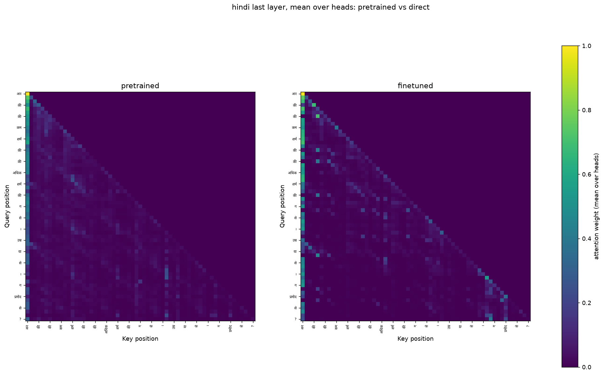
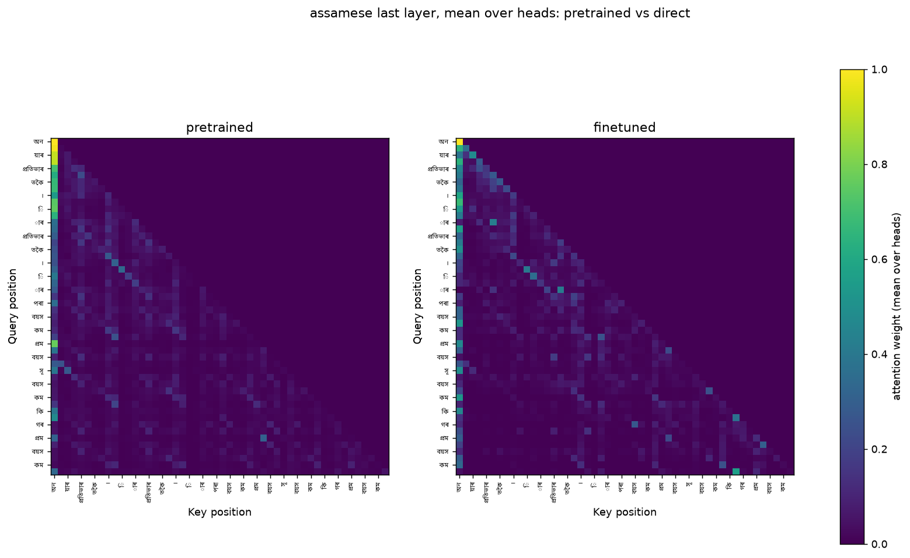

# Phase 3 Technical Report: Relational Reasoning via Direct SFT vs. Chain-of-Thought

**Course**: Language Models and Agents (Monsoon 2026)  
**Author**: Shubhadeep Mandal (Roll No: 2025201056)  
**Scope**: Baseline V1 and Modern V2 (Phase 2) in Hindi and Assamese, each fine-tuned with Direct SFT and CoT SFT; 44 fine-tuning runs (2 seeds per recipe), plus harder evaluation splits, a leakage analysis and an attention analysis.

Every number below is read from [`report/results/`](results/) and every figure is drawn from it by [`report/make_figures.py`](make_figures.py) (provenance: [`report/results/README.md`](results/README.md)).

---

## 1. Executive Summary

| Model | Best Direct recipe (test relation acc.) | Best CoT recipe | Depth 4 / 5 / 10 (kept Direct checkpoint) |
|---|---|---|---|
| Hindi V1 | **0.945 ± 0.016** (realmix) | 0.754 ± 0.044 (realmix) | 0.974 / 0.986 / 0.846 |
| Hindi V2 | 0.880 ± 0.029 (realmix) | 0.688 ± 0.027 (realmix) | 0.952 / 0.968 / 0.856 |
| Assamese V1 | 0.831 ± 0.003 (CoT warm-up) | 0.703 ± 0.001 (realmix) | 0.874 / 0.788 / 0.296 |
| Assamese V2 | 0.631 ± 0.042 (CoT warm-up) | 0.577 ± 0.003 (realmix) | 0.746 / 0.752 / 0.662 |

*Mean ± std over seeds 42 and 43; the majority-relation baseline is 0.481; before fine-tuning every model scores 0.000–0.049 (it does not produce answers in the required form).*

1. **The models learn the task and generalise beyond their training depth.** Training queries span at most 3 hops; Hindi V1 Direct scores 0.974, 0.986, 0.960, 0.906 and 0.846 at 4, 5, 6, 8 and 10 hops. On these deeper splits a lookup of training answers scores at chance (Section 5), so the accuracy is not memorisation.
2. **Direct SFT beats CoT SFT** for every model in both languages, on every split but one (Assamese V1 at 10 hops: CoT 0.380, Direct 0.296).
3. **V1 beats V2 in both languages**, the reverse of their pretraining perplexity ranking (Phase 2).
4. **The recipe matters more than the architecture**: mixing real names into training (realmix) adds 0.07–0.10 for Hindi Direct; a CoT warm-up adds 0.18 for Assamese V1 Direct; dropout 0.1 hurts every cell it was tried in.
5. **Weak spots**: premises about a *different* attribute mislead every model (Hindi Direct falls to 0.73), and the weaker models' answers stop naming the queried pair on 10-hop chains (Assamese V1 Direct 0.296).
6. **Fine-tuning re-wires the later layers**: attention in layers 5–7 changes most, and in Direct models the last prompt token puts 0.72–0.99 of its final-layer attention on entity names (Section 7).

---

## 2. Synthetic Reasoning Dataset

The generator ([`<lang>/finetune/generate_reasoning.py`](../hindi/finetune/generate_reasoning.py)) produces examples whose answers are computed by a symbolic solver over a relation graph ($>$, $<$, $=$), never written by hand or by an LLM.

### 2.1 Task
Each example states premises comparing named people on one attribute (Hindi उम्र, लंबाई, बचत; Assamese বয়স, উচ্চতা, সঞ্চয়) and asks about one pair. A Hindi test example (conversational paradigm, 3 hops):

> **Prompt:** नरेन ने कहा कि नरेन की बचत देवयानी की बचत से कम है। अपराजिता ने कहा कि देवयानी की बचत अपराजिता की बचत से कम है। अपराजिता ने कहा कि अपराजिता की बचत सुचित्रा की बचत से कम है। सुचित्रा ने पूछा कि क्या सुचित्रा की बचत नरेन की बचत से कम है?  
> **Direct target:** सुचित्रा की बचत नरेन की बचत से अधिक है।  
> **CoT target:** [कारण: सुचित्रा > अपराजिता और अपराजिता > देवयानी और देवयानी > नरेन इसलिए सुचित्रा > नरेन] सुचित्रा की बचत नरेन की बचत से अधिक है।

The Assamese generator mirrors it (`[কাৰণ: … সেয়ে সুচিত্ৰা > নৰেন] সুচিত্ৰাৰ সঞ্চয় নৰেনৰ সঞ্চয়তকৈ বেছি।`).

Paradigms: **transitive**, **word problem**, **conversational** (train and eval), **negation** (5% of train, "A is not less than B"), and **multi-hop** (eval only, held out from training).

### 2.2 Anti-leakage design
* **Disjoint names**: separate train, validation and test name pools; training also uses freshly generated syllable-built names, filtered against the val/test pools. *Realmix* replaces half of the training names with real names from the curated train pool.
* **No shortcut through wording**: premises are stated in random direction and order; the question asks about a relation (more / less / equal, 0.4/0.4/0.2) drawn independently of the answer, so echoing the question's relation word scores below the majority baseline.
* **Depth**: half of the training queries are at least 2 hops apart; no training query exceeds 3 hops.
* **Sizes**: 300,000 (Hindi) / 480,000 (Assamese) training examples; 1,000 validation; 2,000 test; 500 per extra split.

### 2.3 Evaluation splits
| Split | What it tests |
|---|---|
| `test` | 2,000 examples, all paradigms, test names, queries ≥ 2 hops |
| `test_depth2` … `test_depth5` | queries exactly 2–5 hops apart |
| `test_depth6`, `8`, `10` | longer chains than any training or earlier test chain |
| `test_branch` | a 3-hop chain plus 3 entities hung off it (irrelevant premises) |
| `test_distractor_attr` | a 3-hop chain plus 3 premises about **another attribute** |
| `test_redundant` | a 4-hop chain plus 3 true shortcut premises (never linking the query pair) |
| `test_balanced` | equal numbers of $>$, $<$, $=$ answers |
| `val_train_names` | validation built with training names (separates name copying from reasoning) |

---

## 3. Fine-Tuning Method

* **Loss**: next-token cross-entropy on the target only; prompt tokens are masked (`ignore_index = -100`). Direct targets are the answer sentence; CoT targets are the `[कारण: …]` rationale followed by the answer.
* **Optimisation** ([`<lang>/finetune/finetune.py`](../hindi/finetune/finetune.py)): AdamW, weight decay 0.1, batch 32, sequence length 192, 300 warmup steps. Hindi: cosine decay over up to 12,000 steps, lr $3 \times 10^{-5}$ (Direct) / $5 \times 10^{-5}$ (CoT). Assamese: warmup-stable-decay over up to 15,000 steps, lr $3 \times 10^{-5}$ (Direct) / $2 \times 10^{-5}$ (CoT). Minimum lr = lr / 10.
* **Checkpoint selection on generated answers**: every 500 steps the model answers all 1,000 validation questions greedily and the best relation accuracy is kept; training stops after 3 probes without improvement, counted only once validation accuracy exceeds the majority rate by 0.1 (some runs sit at chance for thousands of steps before learning). Validation loss is not used: it rises while answers keep improving.
* **Variants** (each with seeds 42 and 43):

| Variant | Change |
|---|---|
| plain | fresh synthetic training names |
| realmix | half of the training names are real names |
| dropout | dropout 0.1 (Hindi) |
| curriculum | 1-hop queries for 2,000 steps, ≤ 2 hops until step 4,000 (Assamese Direct) |
| cot_warmup | Direct, but trained on CoT targets for the first 5,000 steps (Assamese Direct) |

* **Kept checkpoint**: for each model and mode, the run with the best **validation** accuracy across variants and seeds; its weights are scored on every split.

### 3.1 Metrics
* **Relation accuracy** (primary): the relation the generated answer asserts between the queried pair (> / < / =), matched to the gold relation; it tolerates misspelt names (character similarity ≥ 0.8), so it measures reasoning rather than name copying.
* **Strict accuracy**: the answer sentence, including both names, exactly as in the gold answer.
* **Name copy**: both queried names appear in the answer.
* **Baselines**: majority relation (0.481 on `test`) and the structure lookup of Section 5.

---

## 4. Results

### 4.1 Sweep (test relation accuracy, mean over 2 seeds)

| Model | Mode | plain | realmix | dropout | curriculum | cot_warmup |
|---|---|---|---|---|---|---|
| Hindi V1 | Direct | 0.875 | **0.945** | 0.712 | | |
| Hindi V1 | CoT | 0.715 | **0.754** | 0.514 | | |
| Hindi V2 | Direct | 0.779 | **0.880** | 0.475 | | |
| Hindi V2 | CoT | 0.640 | **0.688** | 0.472 | | |
| Assamese V1 | Direct | 0.655 | | | 0.523 | **0.831** |
| Assamese V1 | CoT | 0.633 | **0.703** | | | |
| Assamese V2 | Direct | 0.585 | | | 0.583 | **0.631** |
| Assamese V2 | CoT | 0.521 | **0.577** | | | |

  
   
  <em>Figure 1: test relation accuracy of every recipe (bars: mean of 2 seeds; whiskers: range).</em>

* **Realmix** helps every cell it was tried in. Synthetic training names are unlike real test names; mixing real names teaches the model to copy names of the kind it is tested on.
* **CoT warm-up** is the best Assamese Direct recipe and the most seed-stable (std 0.003 for V1). Five thousand steps of CoT targets followed by Direct targets reach 0.831, against 0.655 for plain Direct.
* **Dropout 0.1** hurts every cell: three of the four stay near chance and Hindi V1 Direct falls from 0.875 to 0.712. The pretrained models were trained without dropout.
* **Curriculum** (short queries first) did not help; Assamese V1 curriculum stayed at 0.523.
* **Seed variance** is large for some Assamese recipes (plain Direct: 0.556 and 0.754), so single-seed comparisons would have been misleading.
* Assamese V1 plain Direct and several Assamese CoT runs reached their best validation score at or near the last step (15,000), so they may be undertrained.

### 4.2 Kept checkpoints on all splits (relation accuracy)

| Model | Mode | test | d2 | d3 | d4 | d5 | d6 | d8 | d10 | branch | other-attr. | redundant |
|---|---|---|---|---|---|---|---|---|---|---|---|---|
| Hindi V1 | Direct | **0.961** | 0.988 | 0.986 | 0.974 | 0.986 | 0.960 | 0.906 | 0.846 | 0.880 | 0.736 | 0.990 |
| Hindi V1 | CoT | 0.799 | 0.852 | 0.808 | 0.766 | 0.720 | 0.618 | 0.366 | 0.130 | 0.634 | 0.482 | 0.616 |
| Hindi V2 | Direct | 0.909 | 0.960 | 0.952 | 0.952 | 0.968 | 0.922 | 0.888 | 0.856 | 0.816 | 0.734 | 0.958 |
| Hindi V2 | CoT | 0.716 | 0.886 | 0.820 | 0.790 | 0.774 | 0.760 | 0.642 | 0.634 | 0.614 | 0.646 | 0.780 |
| Assamese V1 | Direct | 0.833 | 0.918 | 0.922 | 0.874 | 0.788 | 0.726 | 0.598 | 0.296 | 0.642 | 0.628 | 0.726 |
| Assamese V1 | CoT | 0.704 | 0.882 | 0.854 | 0.740 | 0.654 | 0.548 | 0.478 | 0.380 | 0.552 | 0.508 | 0.536 |
| Assamese V2 | Direct | 0.689 | 0.810 | 0.796 | 0.746 | 0.752 | 0.742 | 0.698 | 0.662 | 0.654 | 0.664 | 0.826 |
| Assamese V2 | CoT | 0.498 | 0.592 | 0.526 | 0.522 | 0.484 | 0.430 | 0.410 | 0.362 | 0.448 | 0.420 | 0.506 |

Majority baseline: 0.46–0.54 on every split. Kept runs: Hindi V1 realmix seed 42 (both modes), Hindi V2 realmix seed 43 (both modes), Assamese V1 cot_warmup seed 42 (Direct) and realmix seed 42 (CoT), Assamese V2 plain seed 43 (Direct) and plain seed 42 (CoT). Re-scoring these checkpoints on Kaggle (`lma-eval-hard`) reproduced the sweep's logged test, depth-4 and depth-5 scores exactly for Direct and within 0.006 for CoT.

  
   
  <em>Figure 2: relation accuracy against the number of hops between the queried entities. Training covers 1–3 hops (shaded).</em>

  
   
  <em>Figure 3: the kept checkpoints on the main test and the three harder premise-structure splits.</em>

### 4.3 Per-paradigm accuracy (main test)

  
   
  <em>Figure 4: answer accuracy per paradigm. Multi-hop is never seen in training.</em>

The held-out multi-hop paradigm is the hardest for all four Direct models but far above chance (Hindi V1 0.913, Hindi V2 0.799), and negation, only 5% of training, is solved as well as the other paradigms by the stronger models (Hindi V1 Direct 0.985).

---

## 5. Is It Reasoning? Leakage Analysis

[`common/leakage_check.py`](../common/leakage_check.py) regenerates the data with the sweep's settings and asks how much of each split can be answered from the training split alone ([`report/results/phase3_leakage_<lang>.json`](results/)). The *structure lookup* replaces names by their order of first appearance and answers with the most common training answer for that premise graph, query and attribute: it reasons not at all, but would score highly wherever test structures also occur in training.

| Split (Hindi; Assamese within 0.01) | Shared names | Duplicate prompts | Structures seen in train | Structure lookup | Majority |
|---|---|---|---|---|---|
| test | 0 | 0 | 0.898 | **0.952** | 0.464 |
| test_depth2 | 0 | 0 | 1.000 | 1.000 | 0.488 |
| test_depth3 | 0 | 0 | 0.990 | 0.998 | 0.466 |
| test_depth4 | 0 | 0 | 0.000 | 0.522 | 0.522 |
| test_depth5 | 0 | 0 | 0.000 | 0.516 | 0.516 |
| test_depth6 / 8 / 10 | 0 | 0 | 0.000 | 0.512 / 0.530 / 0.512 | same |
| test_branch | 0 | 0 | 0.000 | 0.462 | 0.462 |
| test_redundant | 0 | 0 | 0.000 | 0.530 | 0.530 |
| test_distractor_attr | 0 | 0 | 0.996 | 0.996\* | 0.522 |

\* The lookup is given only the real premises; the distractor premises it ignores are exactly what misleads the models.

**Reading.** Names and prompts never leak. But the main test and the 2–3-hop splits are *structurally* covered by training: memorising which answer goes with which premise graph would already score 0.95. High main-test accuracy alone is therefore not evidence of reasoning. The evidence is the 4–10-hop, branch and redundant splits, where no test structure occurs in training and the lookup is at chance: there Hindi V1 Direct scores 0.85–0.99 and Hindi V2 Direct 0.82–0.97. These models apply the relation step by step to chains they have never seen.

---

## 6. Error Analysis

1. **Other-attribute premises mislead every model.** On `test_distractor_attr` the Hindi Direct models fall to 0.736 / 0.734 although their answers name the right pair (name copy 1.000 / 0.954): they combine premises about another attribute (e.g. height when the question is about savings) into the chain. The models track *who is compared with whom* but not reliably *on which attribute*.
2. **Long chains break the answer format before the reasoning.** Below-chance scores on 10-hop chains (Hindi V1 CoT 0.130, Assamese V1 Direct 0.296) come with low name-copy rates (0.114 and 0.388): the answer no longer names the queried pair, so no relation can be read from it. Prompt truncation is ruled out: the longest 10-hop prompt is 213 tokens and the longest CoT rationale 114 tokens, within the 512-token context and the 192-token generation limit used for CoT.
3. **CoT errors compound.** A CoT model must restate every premise of the chain; its accuracy falls steadily with depth (Hindi V1 CoT 0.852 at 2 hops, 0.618 at 6, 0.130 at 10), while the Direct model stays above 0.84. Strict accuracy, which requires the names spelt exactly, is below relation accuracy for every CoT model (Hindi V1 test: 0.741 vs 0.799; Assamese V2: 0.351 vs 0.498) and equal to it for Hindi V1 Direct: the CoT models also misspell names while copying them through the rationale.
4. **Redundant true premises help the strong models only.** Compared with plain 4-hop chains, shortcut premises raise Hindi V1 Direct (0.974 → 0.990), Hindi V2 Direct (0.952 → 0.958) and Assamese V2 Direct (0.746 → 0.826), but lower Assamese V1 Direct (0.874 → 0.726) and the Hindi V1 and Assamese V1 CoT models (0.766 → 0.616, 0.740 → 0.536): weaker models are distracted even by true premises.
5. **The "equal" relation is the weakest for the weaker models.** Assamese V2 Direct recalls `=` answers on the main test only 0.364 of the time (0.722 / 0.693 for `<` / `>`); equality is 5.5% of the main test and is learned last.
6. **V2 copies names less reliably.** Hindi V2 Direct names the queried pair in 0.926–0.962 of answers against 0.996–1.000 for V1, and Assamese V2 CoT in about half; part of the V1–V2 gap is name copying rather than reasoning.

---

## 7. Attention Before and After Fine-Tuning

[`common/attention_shift.py`](../common/attention_shift.py) ran each pretrained model and its kept Direct and CoT checkpoints on the same 200 depth-4 test prompts (Kaggle `lma-eval-attention`; [`report/results/phase3_attention_shift_*.json`](results/)). Per layer, averaged over heads, query positions and prompts: the Jensen–Shannon divergence of each attention row from the pretrained model's row (how much attention changed), and the share of the last prompt token's attention that falls on tokens of entity names (the information the answer depends on).

  
   
  <em>Figure 5: top, JSD from the pretrained attention per layer; bottom, last-token attention on entity names (grey: pretrained).</em>

| Model | JSD layers 0–2 | JSD layers 5–7 | Entity attention, last layer: pretrained → Direct (CoT) |
|---|---|---|---|
| Hindi V1 | 0.03–0.07 | 0.20–0.29 | 0.55 → **0.81** (0.38) |
| Hindi V2 | 0.04–0.08 | 0.14–0.21 | 0.48 → **0.72** (0.45) |
| Assamese V1 | 0.05–0.20 | 0.16–0.28 | 0.53 → **0.99** (0.80) |
| Assamese V2 | 0.03–0.17 | 0.17–0.25 | 0.31 → **0.86** (0.62) |

1. **Fine-tuning changes the late layers most.** Layer-0 attention is nearly unchanged (JSD 0.03–0.05) while layers 5–7 change three to nine times as much: the general language processing of the early layers is reused and the task is learned on top.
2. **Direct models learn to read the names.** Before fine-tuning, the last prompt token (where the answer starts) puts 0.31–0.55 of its final-layer attention on entity-name tokens; after Direct fine-tuning, 0.72–0.99. CoT models shift less (0.38–0.80) because they generate a rationale before the answer and need not gather the answer's information at the prompt's last token.
3. **Attention becomes sharper**: mean entropy falls in most layers after fine-tuning, most in the late layers (e.g. Hindi V1 layer 6: 1.96 → 1.03 nats for Direct).

  
   
  
   
  <em>Figures 6–7: last-layer attention (mean over heads) on the first depth-4 prompt, pretrained (left) and after Direct fine-tuning (right). The other two models: <a href="figures/phase3_attention_pair_hindi_v2_direct.png">Hindi V2</a>, <a href="figures/phase3_attention_pair_assamese_v2_direct.png">Assamese V2</a>.</em>

---

## 8. Conclusions

* Small monolingual models (25M parameters, 500M pretraining tokens) can learn multi-step relational reasoning from synthetic supervision and apply it to chains three times longer than any in training, in both a higher- and a lower-resource language.
* **Direct SFT is better than CoT SFT at this scale**: a rationale gives the model more tokens to get wrong, and errors in it compound with depth.
* **The lower-resource language learns the task less well** (best 0.831 vs 0.945) and less stably across seeds, but the right recipe (CoT warm-up) closes much of the gap for V1.
* **Main-test accuracy overstates reasoning on this benchmark**, because its structures occur in training; deeper and structurally new splits are needed, and are where the evidence for generalisation lies.
* **Open weakness**: attribute binding. Premises about a different attribute are wrongly used by every model; a training set with mixed-attribute premises is the natural next step.

---

## 9. Deliverables

| Deliverable | Location |
|---|---|
| Reasoning data generator (both languages) | `hindi/finetune/generate_reasoning.py`, `assamese/finetune/generate_reasoning.py` |
| Fine-tuning pipeline | `hindi/finetune/finetune.py`, `assamese/finetune/finetune.py` |
| Checkpoint scorer, leakage check, attention shift | `common/evaluate_finetuned.py`, `common/leakage_check.py`, `common/attention_shift.py` |
| Tests | `common/test_reasoning_extras.py` |
| Results and figures | `report/results/phase3_*.json`, `report/make_figures.py`, `report/figures/phase3_*.png` |
| Kaggle runs | `seronic2001/lma-finetune`, `lma-finetune-assamese` (sweep), `lma-eval-hard` (harder splits), `lma-eval-attention` (attention) |
